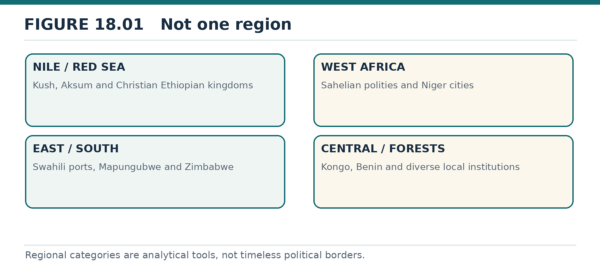

Представи си един търговец, приближаващ град Тимбукту през XIV век. След дни на пътуване керванът е прекосил участъците на Сахара, като се движи между кладенци и селища. Нейните товари могат да съдържат сол от пустинни мини, плат, метални стоки и други изделия с купувачи по-на юг. В края на системата на река Нигер търговските възможности се умножават: лодките носят зърно и други продукти, търговците спорят за стойност и кредит, а учените обсъждат книги, които са преминали през мрежи, простиращи се далеч отвъд всяко едно кралство. Тази сцена е историческа реконструкция, а не доклад за пътуване на определен търговец. Тя улавя реалност, която заслужава да бъде поставена в центъра на световната история: Сахара беше опасна, но не беше непробиваема стена.

Африка е континент с огромни регионални различия. Средиземноморският бряг, атлантическият гори, покрайнините, планините на Етиопия, централните африкански тропически гори, саваните на островите в южния и Индийския океан създават рязко различни възможности за земеделие, пътуване и селище. Континентът също е по-голям от много познати световни карти предполага: проекцията Mercator преувеличава регионите с висока ширина и може да намали очевидния мащаб на Африка в сравнение с Европа и Северна Азия. Човешките общности реагираха на тези среди с различни култури, животни, технологии, езици, институции и системи за търговия.

Няма последователна единствена "Африканска империя," която да може да устои на цялото минало. Древният Куш не е бил средновековен Мали; пристанищата на Килва не са били вътрешният град на Великото Зимбабве; кралство Бенин сега не е страната, наречена Бенин; и човек, който живее в 16-ти век Конго, не е преживял същия политически свят като някой в Аксум хиляда години по-рано. Тази глава следва взаимосвързана история, а не единна цивилизация. Широкият географски обхват на страната означава също така, че някои региони получават само въведение. По-късно глави за исляма, Атлантическия океан, колонизацията и съвременните държави ще се върнат към тези истории с нови въпроси.

<figure class="figure" id="figure-18-1">

<figcaption>Фигура 18.1. Регионалните категории са аналитични инструменти, а не вечни политически граници. <a class="figure-anchor" href="#figure-18-1" aria-label="Link to this figure">#</a></figcaption>
</figure>
