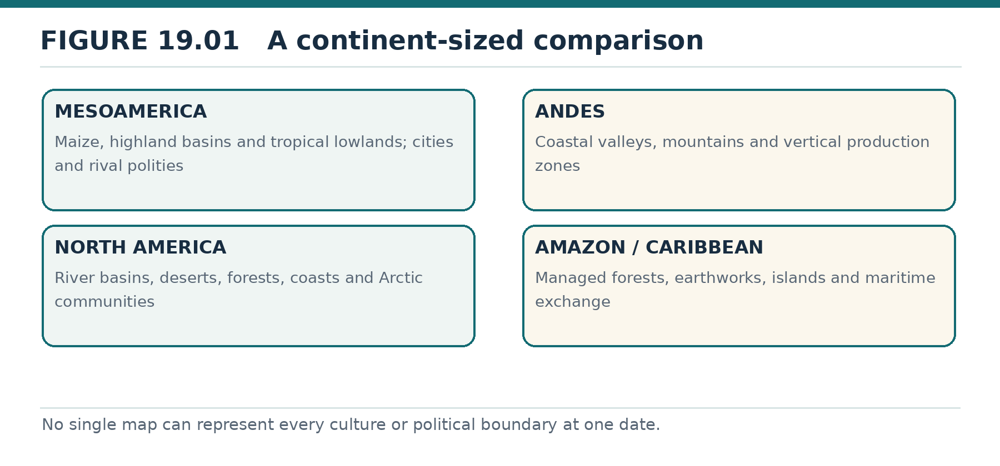

Представи си, че се приближиш до Теночитлан в началото на 16 век. Издигната пътека се простира напред през езерото Тексоко. Канута се движат през канали, пренасящи храна и стоки. Отвъд тях се издигат храмове, дворци и оживени пазари; заедно с изградения град са интензивно култивирани парцели, известни като Китай, внимателно успели да доставят храна на голямо градско население. Хората идват и си отиват говорейки различни езици и носещи задължения към различните политически органи. Сцената е исторически информирана реконструкция, а не очевидец. Той задава един прост въпрос: как се е развил такъв огромен град в свят, чиято далечна история много външни хора са знаели толкова малко?

Тенохтитлан бил едно поразително постижение сред мнозина. Векове по - рано маите записали царските истории в сложна система за писане и проследили дълги интервали в внимателно изчислените календари. В Андите обществата строят церемониални центрове, напояват сухи долини и изграждат пътища през страшни планини. На наводнението в Мисисипи строителите издигнали огромни земни паметници; в Североамериканския Югозапад общностите организирали сложни селища и регионален обмен. В Амазония новите археологически техники разкриват внимателно управлявани пейзажи, които старите предположения са пропуснали. Нито едно от тези събития не изисква история, в която америките са били изолирани, празни или чакащи да бъдат открити.

Заглавието "преди европейското завоевание" е практическа граница, а не твърдение, че местната история е приключила при първия контакт. Последователността от срещи варираше: Атлантическите пътешествия започнаха да трансформират карибските животи от 1492 г., водената от Мексика империя бе победена през 1521 г., държавата Инка се сблъска с инвазия от 1532 г., а много други местни общества продължиха да преговарят, да се съпротивляват и трансформират през следващите векове. Нито беше 1492 първият момент, в който хората извън Америките някога достигаха своите брегове; Северните пътешествия достигнаха Северния Атлантик векове по-рано, без да произвеждат последиците от по-късна колонизация на полукълбото. Хората, обсъждани тук, имат живи потомци и в много региони непрекъснато общности и езици днес.

<figure class="figure" id="figure-19-1">

<figcaption>Фигура 19.1. Нито една карта не може да представлява всяка култура или политическа граница на една дата. <a class="figure-anchor" href="#figure-19-1" aria-label="Link to this figure">#</a></figcaption>
</figure>
