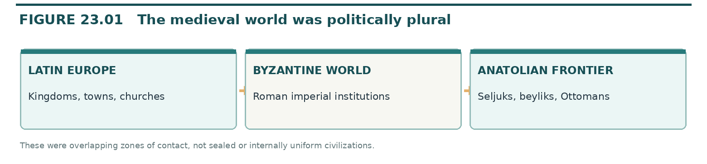

Представете си трима пратеници, които пристигат в Константинопол през пролетта на 1453 г. Един човек е пътувал от западен християнски съд, носейки писма за преговори и помощ, която може да дойде твърде късно. Друг е прекосил Балканите, където владетели и семейства са прекарали поколенията на път към османското данъчно облагане, съюзи и войни. Третият подход от лагера на Султан Мехмед II, където артилерийски екипажи, войници, инженери, моряци и администратори подкрепят огромна обсада. Това е умишлено изградена учебна сцена, а не документирано събиране на трима конкретни мъже. Помага ни да разберем как един град може да застане на кръстовището на няколко истории.

От вътрешността на стените си владетелят Константин XI все още претендирал за достойнството на римски император. Състоянието му е малко в сравнение с неговите средновековни предшественици, но неговата църква, закон, език и политическа памет достигат през вековете. През границата стоеше династия, която се беше появила едва около век и половина по-рано и вече командваше населението на различни езици и вероизповедания. Далеч по-западен лежат царства, княжества, градски републики и църкви, чиито съперничество усложнява всяка колективна реакция. За да разберем 1453 трябва да устоим на простата история на една стара цивилизация, изтощена от млада и неустоима. Резултатът бил оформен от данъци, династични войни, търговски привилегии, религиозно разделение, география, военна организация и решения, взети в продължение на няколко поколения.

Затова въпросът, който ръководи тази глава, е по-широк от този, който победи Константинопол. Как средновековните правителства са придобили ресурси и легитимност? Защо европейските региони разработиха различни политически договорености? Как си взаимодействат византийските, българските, сръбските, латинските и османските светове? И как може загубата на имперска столица да съвпадне с оцеляването и преоткриването на много от нейните традиции?

<figure class="figure" id="figure-23-1">

<figcaption>Фигура 23.1. Това са припокриващи се зони на контакт, които не са запечатани или вътрешно еднакви цивилизации. <a class="figure-anchor" href="#figure-23-1" aria-label="Link to this figure">#</a></figcaption>
</figure>
