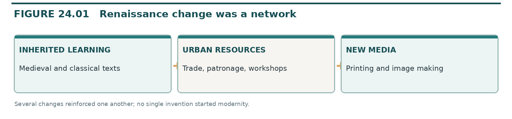

Представете си посетител, който минава през Флоренция около 1475. В магазина за ръкописи читателят сравнява екземпляри от латинска класика, чудейки се дали поколения книжници са въвели грешки. На кратко ходене, художник спори с покровител за цената на пигментите и позиционирането на фигурите в олтар. В търговския офис, кореспонденцията записва дългове, движения на кораби и обменни курсове. Някъде отвъд Алпите принтерите в немските градове вече подготвят множество почти идентични копия на книги, като подреждат метални букви на страници с възможност за повторно използване. Това е сложна учебна сцена, а не запис на индивидуален посетител. Нейната точка е, че културните промени са настъпили в магазините, броячите, училищата и съдилищата, както и в съзнанието на известни гении.

Терминът Ренесанс, което означава прераждане, се отнася особено за европейско културно движение, свързано с възстановяването, изучаването и имитацията на класическата гръцка и римска подготовка. Най-силните му ранни центрове са били в италиански градове от XIV век и свързаните с тях подходи са се развили другаде през следващите два века. Но самото прераждане е историческо твърдение. Хората, които похвалиха собственото си подновяване понякога преувеличиха предполагаемото невежество на своите средновековни предшественици. Те наследили университети, търговски институции, християнска стипендия, ислямски и византийски предавания на древни знания и художествени традиции, които никога не са преставали да се развиват.

Тази глава пита защо италианските градове са станали особено плодородни центрове за експериментиране, какво всъщност изучават хуманистите, как са финансирани изкуството и стипендията, защо техниките на представяне на природата имат значение и как печатът е променил мащаба и политиката на комуникация. Също така се пита чий опит са тези известни промени изключени. Ренесансът не бил нито чудо, извършено от няколко личности, нито мигновеното изобретение на съвременния свят. Беше набор от свързани трансформации с по-ранни корени и неравни последици. \[<a href="/024-renaissance-humanism-and-printing/sources/#source-1" class="cite">1</a>\]\[<a href="/024-renaissance-humanism-and-printing/sources/#source-2" class="cite">2</a>\]

<figure class="figure" id="figure-24-1">

<figcaption>Фигура 24.1. Няколко промени се засилиха взаимно; нито едно изобретение не започна модерност. <a class="figure-anchor" href="#figure-24-1" aria-label="Link to this figure">#</a></figcaption>
</figure>
