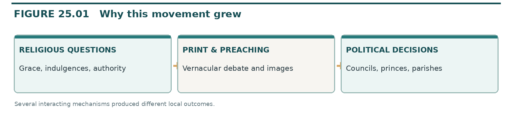

Представете си есенна сутрин в немски град през 20-те години на XX век. Принтерът отваря капаците си, за да покаже свежа инкрустирана брошура. Търговецът купува копие, може би защото дърворезбата показва познат проповедник, критикуващ богатите духовници. На пазара двама съседи спорят дали християните се нуждаят от свещеник, за да тълкуват стиховете. Един градски съветник се чудел дали промяната на публичното поклонение щяла да донесе мир, данъчен спор или гневът на един съседен принц. Една вдовица се тревожи, че молитвите за починалия си съпруг могат да бъдат изоставени. Това е обща учебна сцена, а не запис на дневник. То обединява проблемите, пред които се изправят различни общности, тъй като религиозните спорове се разпространяват из градовете, селата и съдилищата.

От разстояние протестантската реформация може да изглежда като проста последователност: Мартин Лутер осъди злоупотребите през 1517 г., печатарската преса разпространи посланието си и Европа се раздели на протестантски и католически страни. Всяка връзка в този контур се нуждае от квалификация. Реформерите не се разбирали помежду си за теологията и поклонението; католиците развивали обновени движения, често се колебаели, договаряли или променяли съюзи; обикновените вярващи не винаги следвали желанията на владетелите. Религиозният конфликт станал особено разрушителен, когато бил свързан с династичното съперничество, собствеността, териториалната юрисдикция и ресурсите на ранните съвременни държави.

Водещите въпроси в тази глава не са само кой е бил прав за доктрината или кой е спечелил конкретни битки. Те са колко различни видове власт се сблъскаха, защо някои призиви към съвестта станаха принудителни институции, как медиите и политическата география промениха резултатите и как европейските конфликти, свързани с един по-голям свят на православни християни, мюсюлмани, евреи и разширяващи се задгранични империи. Религиозният аргумент може да бъде искрен относно спасението и едновременно да променя наема, училищата, брачното право и международната дипломация. Тази сложност е историята, която трябва да разберем. \[<a href="/025-reformation-and-religious-conflict/sources/#source-1" class="cite">1</a>\]\[<a href="/025-reformation-and-religious-conflict/sources/#source-2" class="cite">2</a>\]

<figure class="figure" id="figure-25-1">

<figcaption>Фигура 25.1. Няколко взаимодействащи механизми доведоха до различни местни резултати. <a class="figure-anchor" href="#figure-25-1" aria-label="Link to this figure">#</a></figcaption>
</figure>
