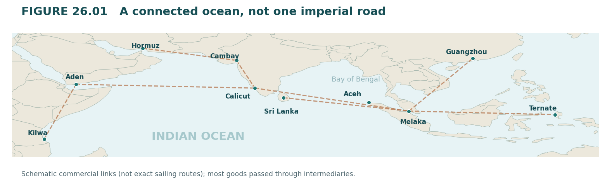

Представете си търговец в пристанището Каликът на индийския Малабарски бряг около 1500. Кораб от Арабския полуостров разтоварва коне и стоки, които не могат лесно да бъдат произведени на място. Наблизо текстилът от Гуджарат е рекурсиран за клиенти от Югоизточна Азия. Пепър минава през брокери, които знаят чужди езици, местни митнически служители и разходите за съхранение. Морякът пита кога благоприятният мусон ще се завърне. Счетоводителят изчислява дали кредитът, удължен с месеци по-рано, може да бъде върнат преди следващото пътуване. Тази сцена е умишлено композитна реконструкция, а не дневник на определен търговец. Нейните части ни помагат да разберем защо търговията през огромен океан може да функционира без една империя да управлява всичките си брегове.

Би било подвеждащо да започнем тази история с португалски кораб. Когато Васко да Гама достига Каликът през 1498 г., търговците вече разменят стоки, практики, хора и вярвания из Индийския океан в продължение на много векове. Търговците свързаха крайбрежието на Суахили с Арабия, Персийския залив с Индия и Бенгалския залив със Югоизточна Азия и Китай. Политическите власти се състезаваха за митнически приходи, плащания за защита и дипломатическо влияние, но обменът се основаваше на споразумения, договорени на местно равнище от хора, които прекрачваха границите на езика, вярата и юрисдикцията.

Системата на Индийския океан не беше хармоничен пазар без принуда. Похитителите били транспортирани през моретата, управниците конфискували кораби, монополи и данъци, облагодетелствали някои търговци пред други, а войната можела да разруши пристанищата. Нито пък беше единна мрежа: различни крайбрежни вериги се припокриваха, а търговците често раздаваха стоки на посредниците, вместо да плават на пълно разстояние. Главата пита как работи такава система, кой е спечелил от нея, кой е пострадал и какво се е променило между 1400 и 1650 г. Това също така задава по-широк въпрос, който ще има значение в следващата глава: дали пристигането с мощни кораби означава, че новодошлите контролират търговията, която се надяват да влязат? \[<a href="/026-indian-ocean-commerce-and-asian-powers/sources/#source-1" class="cite">1</a>\]\[<a href="/026-indian-ocean-commerce-and-asian-powers/sources/#source-2" class="cite">2</a>\]\[<a href="/026-indian-ocean-commerce-and-asian-powers/sources/#source-3" class="cite">3</a>\]

<figure class="figure" id="figure-26-1">

<figcaption>Фигура 26.1. Нито един орган не управлява цялата мрежа. <a class="figure-anchor" href="#figure-26-1" aria-label="Link to this figure">#</a></figcaption>
</figure>
