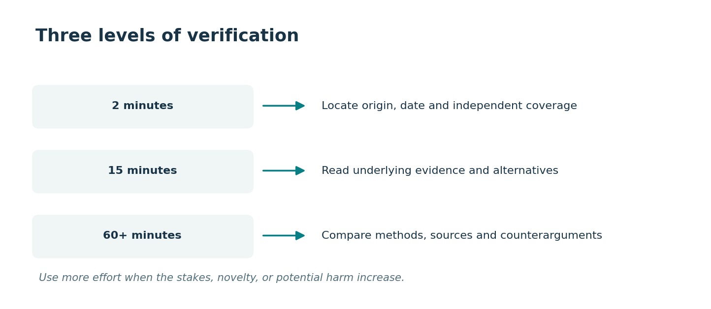

Не всеки иск заслужава един следобед в библиотеката. Трябва ти метод, който да пасва на залозите.

## Две минути: ежедневната проверка

Посочи искането в едно изречение. Идентифицирайте дали тя е описателна, причинно-следствена, прогностична или оценителна. Потърси източника и датата. Търсене на втори, истински независим източник или авторитетно резюме. Ако не можете да установите един основен факт бързо, не го препращайте, както е установено. Кратка пауза предотвратява изненадващата сума на избягваща дезинформация.

## Петнадесет минути: последваща проверка

Намерете основния доклад, предаване на данни, пълно видео, или първични исторически доказателства. Сравни какво всъщност пише със заглавието. Дефиниции за отбелязване, съответната група за сравнение, размера на ефекта и нерешените ограничения. Идентифицирайте поне една правдоподобна алтернативна интерпретация. Ако темата има експертен консенсус, научете какво е и кои части остават отворени. Завърши с кратко изявление увереност.

## Един час или повече: сериозното разследване

За въпрос, който ще преподавате, публикувате, вземате скъпо решение или използвате, за да съдите друг човек, четете конкурентни висококачествени обяснения. Отделни независими източници от копия. Проверете хронологията и методите. Напиши таблица с доказателства: твърдение, източник, това, което източникът директно установява, ограничения, и какво ще промени заключението ти. Не позволявайте на изчерпателните изследвания да се превърнат в начин за избягване на решението завинаги; знайте каква точност е пропорционална на последиците.

<figure class="figure" id="figure-1-5">

<figcaption>Фигура 1.5. Съвпада с интензивността на проверка на решението. <a class="figure-anchor" href="#figure-1-5" aria-label="Link to this figure">#</a></figcaption>
</figure>

## Личният ти бележник с доказателства.

Създаване на страница с шест колони: Твърдение / Защо има значение / Най-добри доказателства / Алтернативно обяснение / Увереност / Следваща проверка. Напълнете го с истински въпрос веднъж седмично. Например: Ученето на чужд език подобрява ли паметта? Скоро ще забележите, че някои въпроси имат ясни фактически отговори, други имат множество взаимодействащи причини, а други зависят от спорните определения. Тетрадката е полезна именно защото тя принуждава тези различия на страницата.
