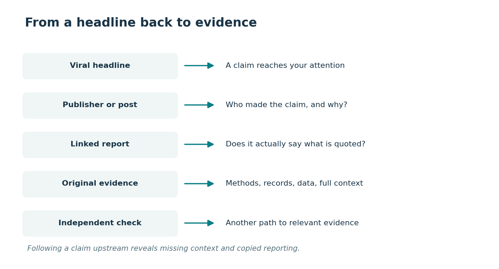

Представете си четене: Нови изследвания доказват, че хората, които пият чай всеки ден живеят десет години по-дълго. Сайтът изглежда елегантен и цитира голям университет. Друг сайт повтаря твърдението. И двете са свързани с влияние. Твърдението сега изглежда добре подкрепено, защото можете да го намерите на няколко места. Но може би всяка версия произлиза от едно съобщение за пресата относно проучване, което откри малка връзка между пиенето на чай и смъртността в една конкретна група. Никой изследовател не твърди, че десет годишно увеличение на продължителността на живота.

За да разследваме, да се върнем назад през информационната верига. Намери статията за новините. Отворете прессъобщението, ако съществува такъв. Намерете изследователска хартия или първоначалното изявление на институцията. Попитайте какво е измервало изследването, кого е включвало и какво всъщност завършват неговите автори. Проверете дали независим експерт го е оценил. Думата доказва, че често е предупредителен знак, когато обектът е сложен и проучването е наблюдателно.

Изследователската програма на Станфорд за граждански онлайн разсъждения показа защо това има значение. В наблюденията на онлайн оценката професионалните проверители често оставят непознат уебсайт, за да разследват миналото му чрез други източници; историците и студентите са по-склонни да останат на оригиналния сайт и да съдят външния му вид. Подходът се нарича странично отчитане. Това не е гаранция за точност, но това е ценен начин да се избегне да бъдат убедени от полирани страница преди да знаете кой стои зад него. \[<a href="/001-how-to-know-what-is-true/sources/#source-2" class="cite">2</a>\]\[<a href="/001-how-to-know-what-is-true/sources/#source-3" class="cite">3</a>\]

Практична версия е методът SIFT, разработен от Майк Коулфийлд: Stop; Разследване на източника; Намерете по-добро покритие; Trace вземания, цитати, и медии в първоначалния контекст. \[<a href="/001-how-to-know-what-is-true/sources/#source-4" class="cite">4</a>\] Това е работен процес, а не строг закон. Може да се наложи да започнете с търсене на източника или сравнение на няколко оригинални записи, а сериозно разследване изисква повече от четири стъпки. Но като ежедневна дисциплина, тя ви дава ефективно място да започнете.

## Когато няколко източника не са наистина няколко източници

Да предположим, че четири вестника докладват една и съща статистика. Вестник Б копира агенция А; Вестник С обобщи Б; Вестник D цитира C. Имате четири публикации, но по същество един основен очевиден път. Тяхното споразумение може да покаже, че историята се е разпространила широко, а не че тя е била проверявана самостоятелно. Проследи веригата на източника. Сравнете директното статистически данни с отделно разследване, като използвате други данни. Попитайте дали са били разгледани алтернативни обяснения.

Също така е възможно да се изисква твърде много от обикновените знания. Не е нужно да четеш цялата научна литература, преди да научиш епохата на Римската империя. Може да бъде подходящо достъпно научно изследване. Степента на разследване следва да се повиши със залозите, новостите, противоречията и последиците от действията по претенцията.

<figure class="figure" id="figure-1-1">

<figcaption>Фигура 1.1. Проследяване на едно твърдение през веригата за докладване. <a class="figure-anchor" href="#figure-1-1" aria-label="Link to this figure">#</a></figcaption>
</figure>
