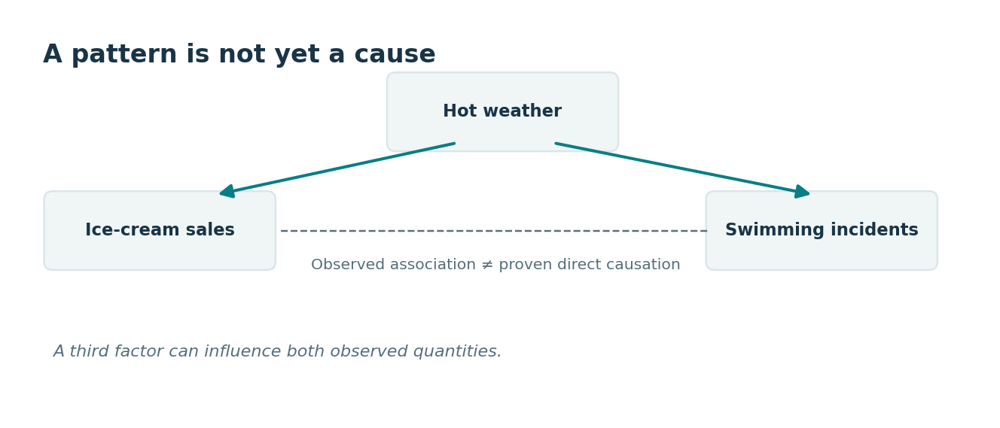

Новият кмет поема поста, а заетостта се увеличава през следващата година. Кметът обявява, че икономическата програма е успяла. Опозицията твърди, че световното възстановяване е създало работните места. Местна бизнес група кредитира нови транспортни връзки. Всяко обяснение може да съдържа част от истината; наблюдаваното увеличение само по себе си не идентифицира причината.

Концептуалната трудност е разнообразяването. Да се каже, че политиката на кмета е причинила увеличението, е да се запитаме всъщност каква би била заетостта, ако тази политика не беше възникнала, при съответните други условия, които са били сравними. Обикновено не можем да наблюдаваме както политическите, така и неполитическите светове за един и същ град едновременно. Ето защо сравняваме: с подобни градове, по-ранни тенденции, разлики в прилагането на политиките или, където е възможно, случайни интервенции.

Три капана се повтарят. Конфузно: трети фактор влияе както на предполагаемата причина, така и на резултата. Горещото време може да увеличи продажбите на сладолед и свързаните с плуването инциденти. Обратна причинно-следствена връзка: посоката върви в обратна посока. По-добро здраве може да позволи на хората да упражняват повече, дори ако упражнения също подобрява здравето. Предубеждение за подбор: хората, които получават лечение или влизат в програма, могат систематично да се различават от тези, които не го правят. По избор програма за обучение може да привлече най-мотивираните студенти; високи оценки сред участниците не изолират ефекта на програмата.

Произволните контролирани проучвания могат да помогнат за измерване на баланса и неизмерените разлики между групите, при условие че се изпълняват правилно и се решават други проблеми с дизайна. Но много важни въпроси не могат да бъдат случайни. Не можем да определим нациите на векове колониално управление или произволно да създадем опустошително земетресение. Вместо това изследователите сравняват естествени експерименти, използват исторически доказателства, тестови механизми и докладват за несигурност. Изследването на наблюденията понякога може да подкрепи убедителна причинно-следствена връзка; то просто изисква допълнителна грижа за предположенията.

Избягвайте противоположната грешка да се предположи, че тъй като корелацията не е достатъчна, корелациите са безполезни. Повторна асоциация може да осигури олово, да помогне да се направят прогнози, или да бъде част от по-голям причинно-следствена аргумент. Един добър изследовател пита как моделът пасва на реалистични механизми, алтернативни обяснения, времеви ред и доказателства от други методи.

<figure class="figure" id="figure-1-2">

<figcaption>Фигура 1.2. Наблюдаваната асоциация може да има обща причина. <a class="figure-anchor" href="#figure-1-2" aria-label="Link to this figure">#</a></figcaption>
</figure>

## Проучване на случая: дали железницата е трансформирала даден регион?

Да предположим, че железницата отвори и регионалната търговия се удвои за десет години. Това има значение. Но за да разберем колко е допринесла железницата, да проучим дали търговската зона също е придобила пристанища, фабрики, население или благоприятни тарифи; дали близките региони без железопътни линии са нараснали по подобен начин; дали стоките са пътували по пътищата преди отварянето на линията и дали самият достъп до нея е бил построен, защото регионът вече е станал по-богат. Един силен отговор може да заключи, че достъпът до железопътния транспорт вероятно е от значение, докато признава, че точният му принос е труден за количествено определяне.

Урокът се отнася от икономическа политика до медицинско лечение и военна история: правдоподобна история за кауза е хипотеза, а не собствено доказателство.
