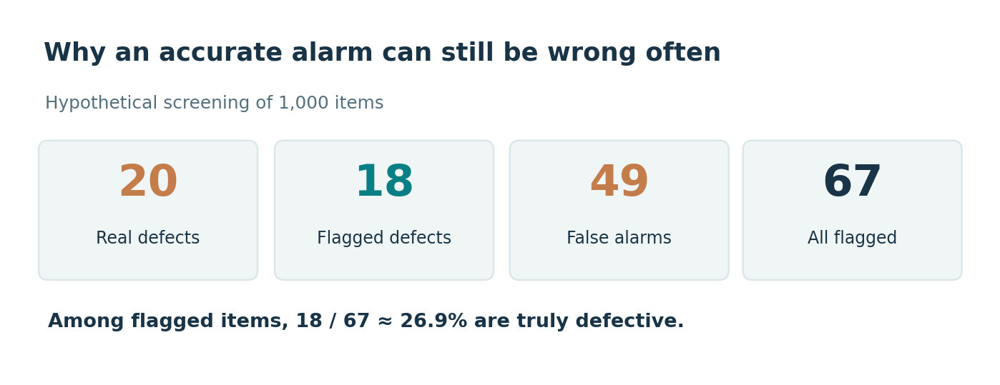

Представете си, че ви е казано, че алармата открива 90 процента дефектни продукти. Алармата се е включила, казва колега. Така че продуктът е почти сигурно дефектен. Това заключение не следва. Също така трябва да знаем колко редки са дефектите и колко често алармата погрешно сигнализира за добри продукти. Глава 3 разработва това изчисление в дълбочина; тук важната идея е, че новите доказателства обновяват това, което сте вярвали преди, вместо да плават независимо от базовата ставка.

Това е интуицията зад Бейзианската логика. Първоначалната вяра, понякога наричана предишна, се преразглежда с оглед на това колко вероятно нови доказателства ще бъдат в рамките на конкурентни обяснения. Резултатът е обновена вероятност или задна. Можеш да разбереш това без да запомниш формула.

Да разгледаме една хипотетична фабрика, която произвежда 1000 продукта. Двадесет са дефектни, а 980 са добре. Проверка устройство правилно знамена 18 дефектни елементи (90 процента чувствителност), но също така погрешно знамена 49 добри елементи (5% false-положителна скорост). Общо той отбелязва 67 позиции, само 18 от които са дефектни. Това означава, че около 27 процента от маркираните предмети всъщност са дефектни, а не 90 процента. Всички количества тук са измислени, за да преподават изчисленията. Промяна на скоростта на дефект или фалшива аларма, и отговорът се променя.

Това може да се чувствам изненадан, защото драматичната нова информация на алармата улавя вниманието ни, докато тихият фон факт е, че почти всички елементи са добри не прави. Същата грешка се появява и при тълкуването на сигнали за измами, проверки за сигурност, тестове за редки заболявания и сензационни новини за невероятни събития. Доказателствата могат да бъдат информативни и все пак оставят значителна несигурност.

<figure class="figure" id="figure-1-4">

<figcaption>Фигура 1.4. Естествените честоти показват защо базовата скорост има значение. <a class="figure-anchor" href="#figure-1-4" aria-label="Link to this figure">#</a></figcaption>
</figure>

Извън цифровите случаи, принципът остава силен. Чухте, че градът губи жители. Първоначалното ви мнение е базирано на десетилетие статистика за населението. Един приятел съобщава, че няколко семейства наскоро са се преместили. Техният доклад е ново доказателство, но не трябва да надвишава добре измерен брой на населението без допълнителна причина. Обратно, новото преброяване, показващо траен спад, трябва да доведе до сериозна актуализация. Вярата, които никога не се променят, са зле калибрирани до доказателства; вярванията, които замахват драматично с всеки анекдот, са слабо калибрирани по друг начин.

Полезният навик е да имаш доверие преди проверката и след това да питаш какво би причинило смислена ревизия. Не е нужно да определяте точните възможности за всичко. За твърдение, което може да се тества,... мисля, че това е правдоподобно, но несигурно е по-честно от изобретяването на 73% увереност, само за да звучи научно.
