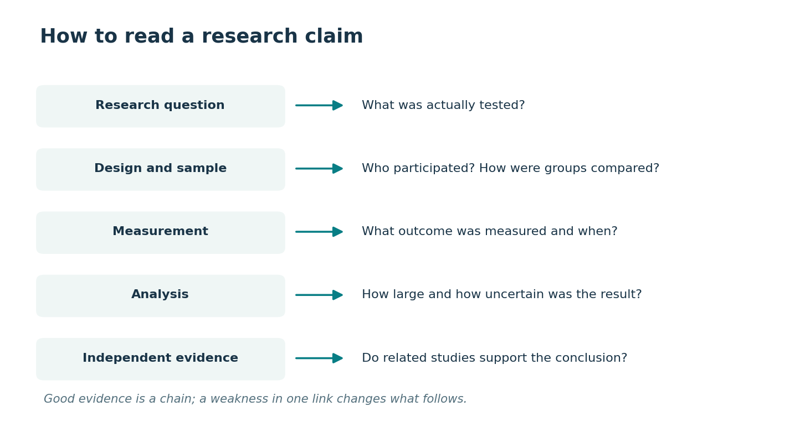

Да предположим, че заглавието казва: го ново проучване установи, че добавка подобрява паметта с 30 процента. Какво искаш да знаеш? Първо, какво е измервано? Може би участниците припомниха 13 думи вместо 10 на тест с 30 думи; това е 30% увеличение спрямо 10 думи, а не 30-процентово подобрение в способността да се помни всичко. Второ, колко участници са били изучавани и как са били наети? Трето, имало ли е надеждна група за сравнение? Четвърто, дали резултатите са били избрани предварително или избрани след разглеждане на много възможности?

Проучване на двадесет доброволци не може автоматично да ни каже какво ще се случи в милиони хора. Дори едно по-голямо проучване може да не успее да обобщи, ако участниците са изведени от тесен възрастов диапазон или настройка. Случайното назначение помага да се разграничи лечението от вече съществуващи различия, но напрягането, лошото измерване, избирателното отчитане и шансът все още могат да изкривят констатациите. Размерът на въздействието задава въпроса колко голяма е разликата; несигурността пита как точно се оценява тази разлика; а практическото значение пита дали разликата има значение в реалния живот.

Статистиката добавя още един капан. А p-стойност понякога се чете погрешно, тъй като вероятността резултатът се е случило по случайност или шанса хипотезата е грешна. Това не са неговите общи значения. Американската статистическа асоциация предупреждава, че p-стойностите не измерват вероятността хипотезата да е вярна и не трябва да бъде единствената основа на решение. \[<a href="/001-how-to-know-what-is-true/sources/#source-6" class="cite">6</a>\] Не е нужно да ставате статистик, за да питате дали авторите отчитат размера на ефекта, интервалите на несигурност, ограниченията на проучването и независимата поддържаща работа.

Когато чуете, че Експертите са доказали, попитайте колко далеч отива първоначалното изследване. Ако основното проучване сравнява две групи за период от четири седмици, то не може пряко да установи 10-годишен резултат. Ако изследването използва мишки, резултатът от него може да бъде научно интересен, без да се установява при хора. Ако изследователите само открият, че две действия се появяват заедно, заглавието не трябва случайно да твърди, че едното поведение е причинило другото.

Най-информационното заглавие често би било най-малко драматично: едно проучване намира скромна асоциация; повече изследвания са необходими. Това е по - малко вероятно да пътува бързо през социалните медии, но е по - вероятно да бъде вярно на доказателствата.

<figure class="figure" id="figure-1-3">

<figcaption>Фигура 1.3. Въпроси, които трябва да зададете, преди да разчитате на нов изследователска резултат. <a class="figure-anchor" href="#figure-1-3" aria-label="Link to this figure">#</a></figcaption>
</figure>
