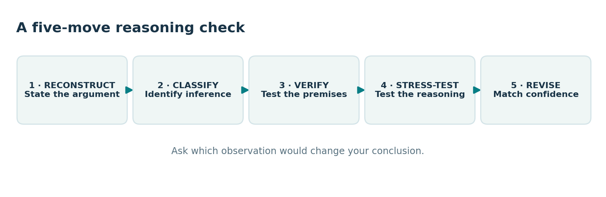

Когато се сблъскаш с трудно твърдение, използвай пет умишлени движения. Първо, реконструирайте го: посочете заключението и причините за него на ясен език. Второ, класифицирай го: дедуктивно заключение, индуктивна прогноза, обяснителна хипотеза или препоръка, която включва и ценности? Трето, проверете помещенията: кои са известни, кои са спорни и какви доказателства ще помогнат? Четвърто, тествайте изводът: действително ли помещенията подкрепят заключението с посочената сила? Пето, формулирайте най-силното възражение и след това преговорете: какво би попитал един справедлив критик и как трябва да се промени увереността или формулировката ви?

Процесът може да отнеме една минута или няколко дни. За всекидневна забележка може да се каже, че това е възможно, но какво друго би могло да го обясни? За сериозно предложение на политиката, можете да изградите електронна таблица, интервю специалисти, да се консултирате с правни документи и да разгледате сравнителни проучвания. Принципните везни на залозите. Разумът не премахва несигурността; това прави реакцията ви на несигурност по-дисциплинирана.

<figure class="figure" id="figure-2-4">

<figcaption>Фигура 2.4. Методът с пет хода може да се използва отново през всекидневните и академичните аргументи. <a class="figure-anchor" href="#figure-2-4" aria-label="Link to this figure">#</a></figcaption>
</figure>

Един допълнителен навик прави метода по-хуманен. Запитай се: ако доказателствата ме изненадат, ще позволя ли това да промени заключението ми? Това не е напътствие да се изоставят присъдите по искане. Силните убеждения могат да се основават на сериозни причини. Това е напомняне, че истинското разследване включва някакъв риск да научиш нещо неприятно. Аргумент, който по принцип не може да бъде преразгледан с каквито и да било възможни доказателства, може да изразява идентичност или морален ангажимент, а не проверима фактическа хипотеза.
