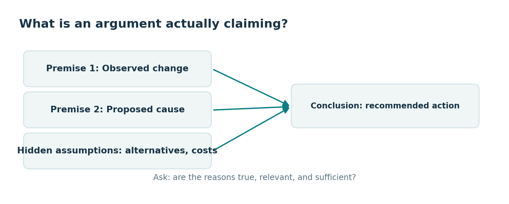

Аргументът във философския смисъл не е кавга. Това е сборник от изявления, в които някои от тях се предлагат в подкрепа на друго, наречено заключение. Да разгледаме този нарочно прост пример: Всички бозайници са топлокръвни. Китовете са бозайници. Затова китовете са топлокръвни. Първите две изречения предоставят причините; последните доставки, които тези причини са предназначени да установят.

Ето защо думите, следователно и в резултат на това често въвеждат заключения; защото, тъй като и при положение, че често се въвеждат помещения. Те са улики, а не правила. В понеделник ще ви кажа, когато нещо се случи, а не защо следва заключение. Много аргументи нямат никакви улики. Упражнява се последователно от шест месеца. Изпълнението й трябва да се подобри. Второто изречение е предсказание, подкрепено от първото.

Изявление, способно да бъде истина или лъжа, понякога се нарича предложение. Мостът отворен през 1980 г. е предложение; Моля затворете вратата като цяло е молба, а не предложение. Аргументите могат да включват команди, въпроси, истории и емоционални призиви, но разсъжденията, които ние оценяваме обикновено зависят от предложения. Това разграничение има значение, защото гневното търсене не се превръща в обяснение само защото то е било доставено уверено.

За да възстановиш аргумента, първо напиши заключението. След това напишете всяка предпоставка отделно. Тогава попитай дали нещо друго трябва да се приеме. Например: Магазинът трябва да удължи часовете си, защото е направил повече продажби в събота. Можем да го реконструираме като: (1) продажбите в събота са надвишили продажбите на типичен ден; (2) по-дългите часове биха довели до достатъчно допълнителни печеливши продажби, които да оправдаят разходите им; (3) поради това магазинът трябва да удължи работното си време. Втората предпоставка, която може би е точно проблемът, беше вкарана в неофициално изречение без обсъждане.

Същият подход изяснява политиката. Тази политика намалява престъпността, така че ние трябва да я приемем, може да прикрие предположения за разходите си, конституционност, странични ефекти, ефективност по отношение на алтернативите и теглото, което поставяме върху различни форми на безопасност. Говорителят може да има право. Но истинските точки не премахват разпродажбите. Картата на аргументите прави твърдението по-скоро спорно, отколкото просто драматично.

<figure class="figure" id="figure-2-1">

<figcaption>Фигура 2.1. Направете скритите предположения видими преди оценката на заключението. <a class="figure-anchor" href="#figure-2-1" aria-label="Link to this figure">#</a></figcaption>
</figure>

<strong>Опитай сега.</strong> Един приятел казва: "Нашият град се нуждае от нова спортна зала." Младите хора си тръгват и спортната зала ще ги накара да останат. Какъв е изводът? Кое изявление се предлага като доказателство? Кое решаващо предположение все още не е проверено? Един полезен отговор ще разграничи стойността на спортната зала от несигурното твърдение, че тя ще обърне миграцията.
