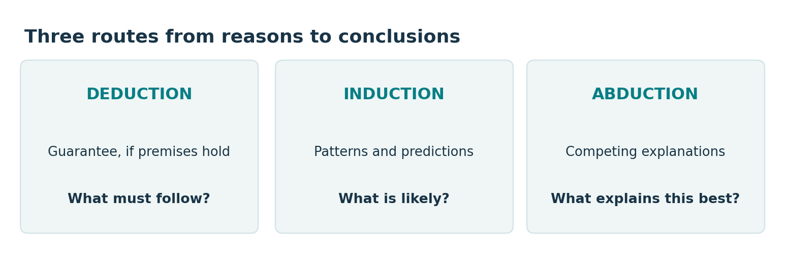

Не всеки аргумент има за цел да осигури дедуктивна гаранция. Най-практично мислене се занимава с несигурност. Представи си, че се събудиш и откриеш улиците на селото мокри. Можете да разгледа три обяснения: дъжд падна през нощта, общински работници изми улиците, или тръба се спука. Доказателствата са непълни. Трябва да разсъждаваш за обяснението, което най - добре пасва на това, което можеш да наблюдаваш.

<strong>Приспадане</strong> пита какво следва задължително от обявените помещения. Индукцията използва наблюдавани случаи, за да подкрепи по-широко обобщение или прогнози, без да го гарантира. Отвличането пита кое обяснение най-добре обяснява доказателствата. Това не са три конкурентни лоялност; ние използваме и трите в обикновена мисъл. Инженерите могат да определят последиците от изпитан модел, надеждността на данните от повтарящите се наблюдения и да диагностицират неизправност чрез сравняване на конкурентни обяснения.

Да предположим, че магазинът отбелязва, че последните му десет петъчни вечери са заети и прогнозират, че следващия петък също ще бъде зает. Това е индуктивно. Доказателствата имат значение, но десет вечери могат да представляват празничен сезон или необичаен период. Една по-силна прогноза пита колко представителна е пробата, дали условията са се променили и колко голяма остава несигурността. Индукцията се подобрява чрез по-добри данни и разумни сравнения; тя не е магически трансформирана в приспадане чрез събиране на много наблюдения.

Да предположим, че петъчните продажби се покачат внезапно. Вие разглеждате три хипотези: магазинът представи популярен продукт; близък конкурент затвори; или реклама донесе в нови клиенти. Това е абдуктивно мислене. Всяко предложено обяснение трябва да бъде изпитано срещу допълнителни подробности. Възходът започна ли преди рекламата? Дали трафикът се е увеличил главно сред купувачите, които са закупили новия продукт? Близките жители докладвали ли са, че ще преминат от конкурента? Обяснението е по-силно, когато става дума за множество наблюдения, има правдоподобен механизъм и не разчита на купчина неподкрепени допълнителни предположения.

Фразата "най-добро обяснение" изисква внимание. Обяснението, което се чувства най-убедително не е непременно най-доброто. Някои причини са често срещани, но емоционално безинтересни; някои драматични истории са запомнящи се, но невъзможни. Обяснението може да бъде сравнено с доказателствата, съответствието с установените познания за миналото, доказаните последици и броя на необяснимите факти, които оставят след себе си. Дори най-доброто обяснение в момента може да бъде преразгледано, когато се появят нови доказателства.

<figure class="figure" id="figure-2-3">

<figcaption>Фигура 2.3. Приспадането, индукцията и отвличането отговарят на различни въпроси. <a class="figure-anchor" href="#figure-2-3" aria-label="Link to this figure">#</a></figcaption>
</figure>
