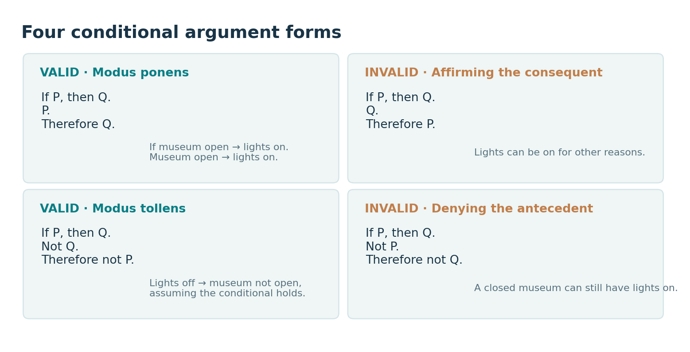

В дедуктивни разсъждения аргументът е валиден, когато няма възможна ситуация, в която всички негови помещения са верни, но заключението му е погрешно. Това определение е за структура. Тя не ни казва дали помещенията действително описват света. Помисли върху следното: Всички влечуги са невидими. Змиите са влечуги. Затова змиите са невидими. Заключението е валидно; първоначалната предпоставка е невярна. Тъй като фалшивата предпоставка не установява заключение относно истинските змии, това не е разумен аргумент.

Аргументът е разумен, ако той е приспаднато валиден и всички негови помещения са верни. Звукът е взискателен стандарт; ние често не можем да установим всяка предпоставка със сигурност, особено по спорни политически или исторически въпроси. И все пак разликата е от съществено значение. Един от въпросите е дали заключението логично следва, ако предоставим помещенията. Друг въпрос е дали трябва да предоставим тези помещения. Добрата дискусия разделя тези въпроси.

Да разгледаме два хипотетични разговора. Ако музеят е отворен, светлините са включени. Музеят е отворен. Ето защо светлините са включени. Ако приемем, че първата предпоставка е вярна, формулярът е валиден. Ако музеят е отворен, светлините са включени. Светлините светят. Затова музеят е отворен. Светлините може да са включени, защото чистачите работят, докато музеят е затворен. Лице Б е направило обща структурна грешка: потвърждавайки последвалото. И двата аргумента звучат еднакво. Само един дава заключение, гарантирано от посочените помещения.

Трета обща форма е отричането на предубеждението: ако музеят е отворен, светлините са включени. Музеят е затворен. Затова светлините са изключени. Светлините може да са включени по друга причина. Заключението не следва. Сравнете това с modus tollens, валиден формуляр: Ако музеят е отворен, светлините са включени. Светлините не светят. Затова музеят не е отворен. Ако условната стойност действително е в сила без изключение, това заключение е валидно. В реалния живот, тогава можете да оспорите условното. Може би музеят има електрически неуспех, но това е предизвикателство към предпоставката, а не към логическата форма.

<figure class="figure" id="figure-2-2">

<figcaption>Фигура 2.2. Две валидни и две невалидни форми на условно мислене. <a class="figure-anchor" href="#figure-2-2" aria-label="Link to this figure">#</a></figcaption>
</figure>

Мощен тест е да се търси контрапример. За да се докаже, че едно заключение е невалидно, опишете една съгласувана възможна ситуация, в която помещенията се държат и заключението се проваля. За пример на музея, чистачите с включени лампи, докато вратите остават затворени, са достатъчни. Един-единствен контрапример може да установи, че предложеното дедуктивно заключение не гарантира неговото заключение. То не показва автоматично, че действителното заключение е погрешно: музеят може наистина да е отворен, но самите светлини не са го показали.

Тази разлика е освобождаваща. Вече не е нужно да правиш обратното на всяко твърдение, в което се съмняваш. Понякога точният отговор е просто:..Вашите доказателства все още не установяват този резултат. Човек може да е прав по други причини. Сегашният аргумент не е стигнал до там.
