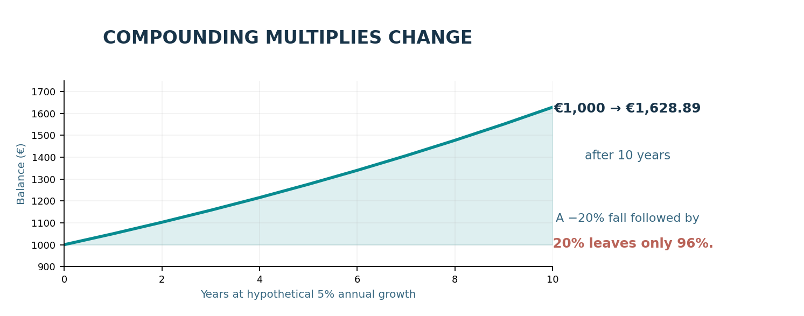

Да предположим, че 1000 € печелят хипотетична 5% годишна възвръщаемост и възвръщаемостта остава инвестирана. След една година балансът е 1050 евро. След две е 1,102,50 евро. След десет, 1000 € × 1,0510... €1,628.89. Десетгодишната печалба се изчислява на по-голяма база от първата година. Това е математика, а не обещание, че всяка инвестиция ще спечели 5%. На реалните пазари възвръщаемостта варира, може да се прилагат такси и данъци и могат да възникнат загуби.

Съединението работи и в обратна посока. Ако една страна преживее 10% инфлация за една година и 10% през следващата, общото увеличение на цената е 1.1 × 1.1 − 1 = 21%, а не 20 процента. Ако акциите падат с 20% след това се покачват с 20%, 100 € става 80 и след това 96 €: инвеститорът все още е надолу с 4%. Възстановяването от 20% загуба изисква 25% печалба. Тази асиметрия е причината големите загуби да заслужават внимание дори когато средната възвръщаемост изглежда привлекателна.

<figure class="figure" id="figure-3-7">

<figcaption>Фигура 3.7. Многократното процентно изменение се прилага за новата сума, а не само за първоначалната. <a class="figure-anchor" href="#figure-3-7" aria-label="Link to this figure">#</a></figcaption>
</figure>

Друг начин да видите разликата е да сравните две заплати. Един се увеличава със 100 евро всяка година. Друг се увеличава с 3% всяка година. За кратък период фиксираната сума може да бъде по-добра; за дълъг период процентът на увеличение може да стане много по-голям, ако постоянно се прилага към новата заплата. Реалните заплати, разбира се, също зависят от инфлацията и данъците. Номиналната заплата може да се увеличи, докато покупателната способност пада.

Има известно грубо умствено правило, което понякога се нарича правило 72. Разделяне 72 на процентен ръст осигурява приблизително брой периоди, необходими за удвояване при стабилно съединение: при 6% годишно, приблизително 12 години. Точното време следва логаритмичната връзка; за 6% растеж, тя е приблизително 11,9 години. Използвайте правилото като оценка, а не като заместител на проверката на предположенията. Съединението може да помогне да се обясни промяната на населението, растежа на дълга и технологичните осиновявания също, но растежът рядко продължава вечно.
