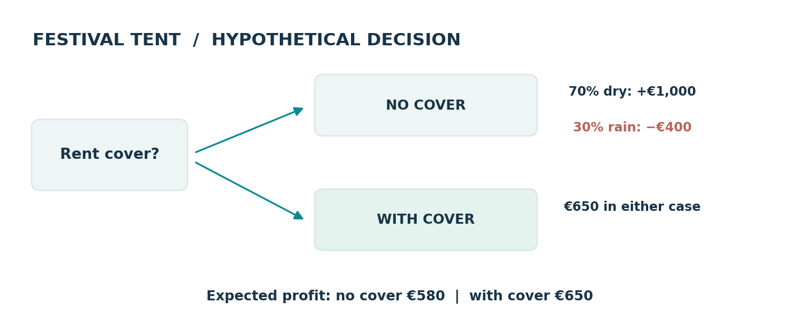

Дървото на простите решения разделя това, което можеш да избереш от онова, което не можеш да контролираш. Започни с екшън. Списък на резултатите, които могат да последват, присвоява правдоподобно вероятности, когато е възможно, идентифициране на последиците, и сравнение на действия. Където вероятностите са неизвестни или силно несигурни, се отбелязва, че изрично, а не изобретяване на прецизност.

Да разгледаме един градски организатор на фестивала, който решава дали да наеме скъпа покрита палатка. Без палатката един сух ден (случайно 70 процента) получава 1 000 € нетна печалба; дъждовен ден (30%) създава 400 € нетна загуба. Очаквана стойност = 0.7 × €1,000 + 0.3 × (- €400) = €580. С палатката, да предположим, че печалбата е 650 евро, независимо дали денят е сух или мокър, след като цената за наем. Очаквана стойност = 650 €. Според тези измислени предположения палатката подобрява очакваната печалба от 70 € и елиминира загубите, предизвикани от времето в този опростен модел.

<figure class="figure" id="figure-3-8">

<figcaption>Фигура 3.8. Дървото за вземане на решения разкрива избор, несигурни състояния, последствия и предполагаеми подкупи. <a class="figure-anchor" href="#figure-3-8" aria-label="Link to this figure">#</a></figcaption>
</figure>

Този пример е лесен, защото осигурихме всяка вероятност и изплащане. Истинският избор рядко предлага такава сигурност. Може би палатката не е напълно водоустойчива; може би присъствието се променя, когато дъждът е прогнозиран; може би парите трябва да бъдат платени предварително. Един зрял човек, вземащ решения, не бърка едно дърво с точно представяне на реалността. Използвайте един, за да разкрие предположения, след това оспорват предположенията чрез използване на критично мислене от глави 1 и 2.

Дърветата с решения могат също така да разкрият стойности, които не се намаляват лесно до евро. Може да се очаква политиката да спасява животи при налагането на разходите за поверителност. Един градски проект може да увеличи общия доход, като същевременно навреди на малцинство от жители. Човек може да избере кариера с по-ниско заплащане, но по-голяма стабилност. Вероятността помага да се организира прогнозата за това какво може да се случи. Етиката и политиката все още са необходими, за да се решат какви последици трябва да имат значение и колко силно.
