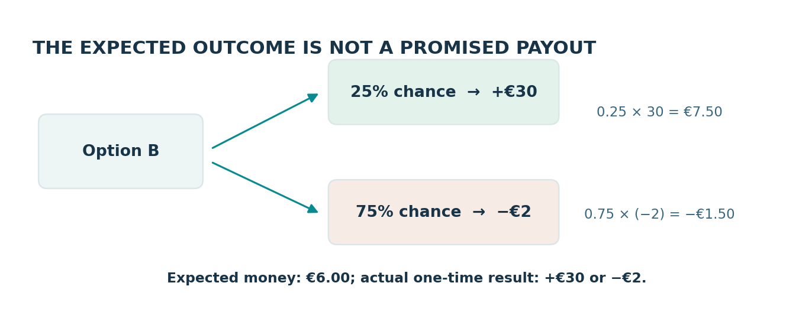

Да предположим, че ти предложат два варианта. Вариант А гарантира печалба от 6 €. Вариант Б предлага 25% шанс за печалба от 30 € и 75% шанс за загуба от 2 €. Очакваната парична стойност на B е 0,25 × 30 + 0,75 × (- 2) = 7,50 EUR − €1,50 = €6. Двете опции имат едни и същи очаквани пари, но резултатите им се чувстват различни. В А резултатът е сигурен; в Б, губите пари три от четири пъти. Ако играете веднъж, вие никога няма да получите действително очакваната €6 от Б. Този брой е средно през възможните резултати, а не обещан резултат.

Очакваната стойност се изчислява чрез умножаване на всеки възможен резултат по неговата вероятност и добавяне на резултатите. Ако резултатите са x1, x2, и така нататък, с вероятности p1, p2 и т.н., очакваната стойност е сумата от всеки p × x. Теглото трябва да обхваща всички взаимно изключващи се резултати и общо 100 процента. За проста игра, в която печелите €12 с вероятност 0.4 и губите €5 с вероятност 0.6, очаквана печалба = 0.4 × 12 + 0.6 × (−5) = € 1.80. Дали трябва да влезете зависи от повече от средната стойност: броят на възможностите, залозите, бюджета ви и надеждността на вероятностите имат значение.

Помислете за бизнес поръчване на допълнителни акции за местно събитие. Ако събитието е натоварено (вероятност 0.3), допълнителната наличност произвежда 450 евро допълнителна нетна печалба. Ако посещаемостта е обикновена (вероятност 0.7), оставащата инвентаризация и разходите създават нетна загуба от 120 €. Очакван нетен резултат е 0.3 × 450 + 0.7 × (-120) = €135 − €84 = €51. Ако тези числа са надеждни и решението може да се повтори, хазартът има положителна очаквана парична стойност. Но един търговец може рационално да го избегне, ако парите са ограничени или акциите не могат да бъдат върнати. Изчисляването информира решението; то не го прави за вас.

<figure class="figure" id="figure-3-4">

<figcaption>Фигура 3.4. Очакваният паричен резултат е среднопретеглена вероятност, а не определено изплащане. <a class="figure-anchor" href="#figure-3-4" aria-label="Link to this figure">#</a></figcaption>
</figure>

Очакваната стойност също може да прикрие колко широко се различават резултатите. Представете си избор, който плаща 1000 евро с един на хиляда шанса и губи 1 € в противен случай. Очакваният резултат е близо до нула, но повечето хора преживяват загубата. Положителната средна стойност не е автоматично добър план за домакинство, особено ако печалбите са редки, залозите не могат да се повторят или най-лошият резултат застрашава основните нужди.
