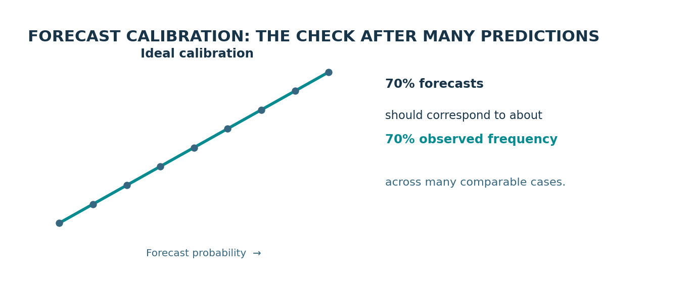

Да предположим, че предсказателят прогнозира 60 процента шанс за събитие в голяма колекция от сравними случаи. Ако тази прогноза е калибрирана, събитието трябва да се случи около 60 процента от времето между тези случаи, като се има предвид достатъчно голяма и подходяща проба. Калибрирането ни показва дали обявените вероятности съвпадат с наблюдаваните честоти. Прогнозатор, който многократно прогнозира 90% и е прав само 50% от времето е прекалено уверен; някой, който предвижда 50 процента за почти всичко, може да избегне екстремни грешки, но предлага малка дискриминация между лесни и трудни случаи.

Калибрирането и остротата отговарят на различни въпроси. Калибрирането е за честността на числата над повтарящи се случаи. Sharpness се отнася до това колко информативни или решителни са прогнозите, независимо дали те смислено различават ниско- от ситуации с висока вероятност, отколкото клъстер безопасно около 50 процента. Отлична прогноза има за цел да бъде както добре калибрирана, така и полезно дискриминираща. Модел, който казва 50 процента за всяка наистина балансирана ситуация, може да бъде добър; модел, който казва 50 процента, дори когато някои събития са почти сигурни, не си върши работата.

<figure class="figure" id="figure-3-6">

<figcaption>Фигура 3.6. Калибрирането сравнява много прогнози с наблюдаваните честоти; схеми, а не емпирични данни. <a class="figure-anchor" href="#figure-3-6" aria-label="Link to this figure">#</a></figcaption>
</figure>

Прогнозите за времето правят този бетон. В терминологията на Националната метеорологична служба на САЩ вероятността за валежи е вероятността дадена точка от прогнозния район да получи измеримо количество валежи за определен период. 30 процента шанс не означава, че дъждът ще падне за 30 процента от часовете, нито пък означава, че точно 30% от района трябва да се намокри. Винаги проверявай кое събитие, посочи и за кой период се отнася прогнозата ти. Различните доставчици могат да изразяват прогнозите по различни начини, така че определенията имат значение.

Публичната политика, изборите и бизнес прогнозите са по-трудни за преценка. Събитията могат да бъдат редки, уникални или променени от самата прогноза. Ако хората чуят, че една компания може да се провали, реакциите им могат да допринесат за нейния провал; ако чуят за предстоящ недостиг, те могат да купят още веднага. Въпреки това, един резултат не е достатъчно, за да се докаже, че вероятността е лоша. Най-добрата оценка използва много сравними прогнози, прозрачни определения и честни записи на това, което е било предсказано, преди да бъде известен резултатът.
