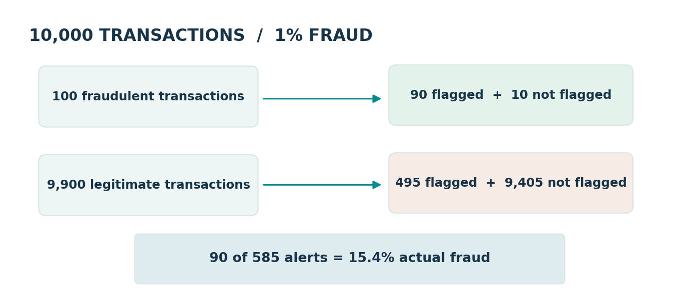

Върнете се към встъпителната история. Представете си точно 10 000 транзакции с 1% измама: 100 измами и 9900 законни покупки. Системата за откриване показва 90% от измамите, така че правилно хваща 90. Тя погрешно отбелязва 5% от законните покупки, което е 495 честни сделки. Общо 585 транзакции получават сигнали, но само 90 от тях са измамни.

Това прави вероятността за реална измама сред маркираните сделки равна на 90 / 585, или около 15.4%. Далеч от твърдението, че купувачът е 90% вероятно да бъде фалшификатор, уликите сочат, че около 84.6% от засечените клиенти в това хипотетично население са законни. Детекторът все още хваща девет от десет измами; проблемът е, че населението с неизмама е много по-голямо.

<figure class="figure" id="figure-3-2">

<figcaption>Фигура 3.2. Надежден процент на откриване не означава надеждна положителна прогноза, когато измамата е рядкост. <a class="figure-anchor" href="#figure-3-2" aria-label="Link to this figure">#</a></figcaption>
</figure>

1%то начало на разпространението се нарича базова честота. Това засяга значението на положителен сигнал. Да предположим, че използваме една и съща система за откриване в много различна среда, където 10% от сделките са били измамни. От 10 000, ще има 1000 измами и 9000 законни покупки. Системата ще отбележи 900 измами и 450 законни покупки, така че 900 / 1,350 = 66,7% от сигналите биха показали реална измама. Софтуерът не се променя; населението го прави.

Това е един от начините да се разбере правилото на Бейс: нови доказателства актуализира стартовата вероятност и резултатът зависи както от качеството на доказателствата, така и от това колко често събитието е било предварително. Не е нужно да запомните уравнението, за да разберете основния принцип: рядкото събитие изисква особено убедителни доказателства, преди да стане възможно в отделен случай. Уравнението за положителен сигнал S и таргетно събитие T е P(T год.) = \[P(S, S, T) × P(T)\] / P(S). Натуралният метод на честотата по-горе е същата логика, изразена като броя.

<strong>Важни граници.</strong> Истинските скрининг системи могат да имат промяна в производителността на населението. Разпространението на измамите може да се премести в различни държави, времена, начини на плащане или търговци. Потребителите могат да се държат стратегически. Трябва да бъде ясно дефиниран и всяко твърдение за дадено лице зависи от модела, който съответства на тяхното положение. Знамето на риска трябва да предизвика следващото разумно разследване, а не декларация за вина.
