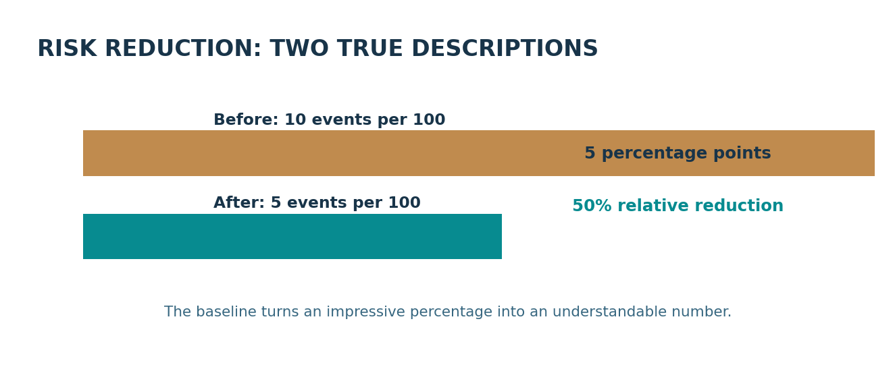

Да предположим, че хипотетичното лечение намалява вероятността от нежелано събитие от 10% до 5% в определена група по време на определен период. Той намали риска с 5 процентни пункта. Също така намалява риска с 50% спрямо първоначалния риск. Тези описания не са противоречиви; те оформят различни характеристики на същия резултат. Абсолютната разлика отговаря колко допълнителни събития на 100 души могат да бъдат избегнати? Каква част от първоначалния риск е била премахната?

Сега промени началния риск: от 2 събития на 10 000 на 1 на 10 000. Това отново е 50% относително намаление, но само едно-събитие на 10,000 абсолютно намаление. Едно заглавие обещаващо да се получи вашия риск ще звучи еднакво и в двете ситуации, въпреки че броят на засегнатите хора е много различен. При оценката на претенцията настоявайте както за относителното число, така и за изходното или абсолютното число.

В изследванията може да се отговори на броя, необходим за лечение, или NNT, оценка на това колко хора ще се нуждаят от конкретна намеса, по време на определен период и в определено население, за да се предотврати едно допълнително събитие в сравнение със сравнителен анализ. В първия хипотетичен пример, абсолютното намаляване на риска е 0,05, така че NNT = 1 / 0.05 = 20. Това е средностатистически за населението при условията на проучването, а не прогноза, че точно един от всеки 20 назовани хора лично ще има полза. NNT може да варира в зависимост от времевия период, основния риск и популацията. Тя трябва да се претегля заедно с неблагоприятните ефекти, разходите и качеството на доказателствата.

Рискът не е само вероятност. Събитие, което има вероятност да причини леко неудобство, заслужава различен отговор от едно на хиляда шанса за трайно нараняване. За решения с висок резултат, трябва да помислим и колко несигурна е самата вероятност. Някой, който ти казва, че екстремното събитие има шанс без доказателства може да се окаже фалшива прецизност. Вероятността може да бъде полезна оценка и все още е слабо известна.

<figure class="figure" id="figure-3-3">

<figcaption>Фигура 3.3. Докладвайте абсолютната и относителната промяна заедно, като винаги определяте базовата линия. <a class="figure-anchor" href="#figure-3-3" aria-label="Link to this figure">#</a></figcaption>
</figure>
