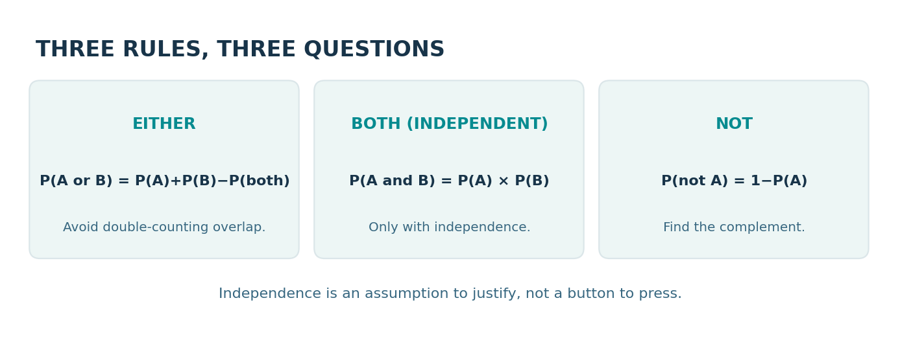

Вероятността често се преподава чрез монети и зарове, защото можем да определим точно възможните резултати. Считай, че е справедливо да умреш. Вероятността за търкаляне на 1 или 2 е 2/6 = 1/3, тъй като двата резултата са взаимно изключващи се: и двете не могат да възникнат на едно и също завъртане. По-общо, ако събития А и Б не могат да се случат заедно, P(A или B) = P(A) + P(B). Ако събитията могат да се припокриват, изваждаме припокриването веднъж: P(A или B) = P(A) + P(B) − P(A и B).

Сега си представи да хвърлиш две монети. Има четири еднакво вероятни резултата: HH, HT, TH и TT. Шансът за две ези-та е 1/4 или 25%. За независими събития, знаейки резултата от едното не променя вероятността за другото, така че умножаваме: P(A и B) = P(A) × P(B), когато А и Б са независими. За две глави 1/2 × 1/2 = 1/4.

Независимостта не е като взаимното изключване. Две различни хвърляния на монети могат да показват ези; тези събития могат да ко-оккурират и, под нашия модел, са независими. Един-единствен зар показва 2 и един и същ залп показва 5 не може да коокюр; те са взаимно изключващи се, но не независими. Ако се случи събитие с положителна вероятност, взаимно изключващата се алтернатива става невъзможна. Объркването на тези термини води до неправилни изчисления и по-лоши прогнози.

Има още един практичен пряк път: допълнение. Ако шансът да изпуснеш влак е 15%, шансът да не го пропуснеш е 85%, като предположим, че тези резултати покриват всички възможности. Това е 1 − P( липсва). По-сложни събития понякога могат да бъдат решени чрез изчисляване на противоположното първо. Ако устройството има 10% независим шанс да се провали при всеки от трите опита, шансът да се провали и трите пъти е 0.13 = 0.001 или 0.1%; вероятността за поне един успех е 99,9%. Тези изчисления зависят критично от предположението за независимост.

<figure class="figure" id="figure-3-1">

<figcaption>Фигура 3.1. Три операции по вероятност отговарят на различни въпроси; предположенията имат значение. <a class="figure-anchor" href="#figure-3-1" aria-label="Link to this figure">#</a></figcaption>
</figure>

<strong>Чек преди да умножиш.</strong> Ако три доставки се забавят от една и съща снежна буря, резултатите им не са непременно независими. Ако повредите на машината идват от общ електрически проблем, три резервни части, задвижвани от една и съща верига, могат да се провалят заедно. Умножението на пределните вероятности за провал, сякаш всяко събитие е независимо, може да направи една опасна система далеч по-безопасна, отколкото е.
