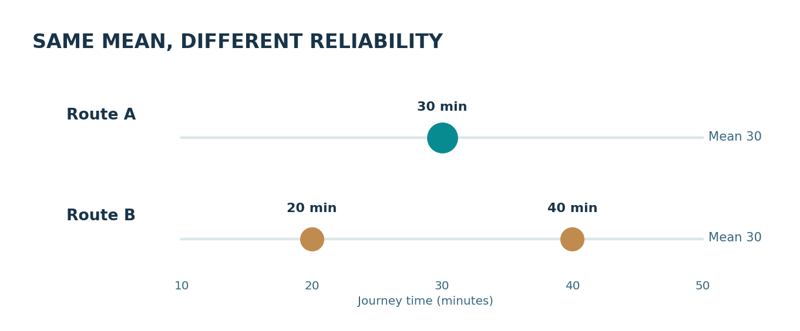

Представете си два автобусни маршрута между селата. Път А отнема точно 30 минути всеки ден. Път Б отнема 20 минути на половин ден и 40 минути на другата половина. И двете имат средно време на пътуване от 30 минути. Но ако имате критична среща след 35 минути, маршрут А е много по-безопасен. Ако пристигането след 20 минути е особено ценно и закъснението има малко последици, може да предпочитате Route B. Средната стойност описва центъра на разпределение, а не неговото разпространение.

Разпределението ни казва кои резултати са възможни и колко често се появяват. Вариацията и квадратният й корен, стандартното отклонение, обобщават колко далеч наблюдения обикновено се разпространяват около средната стойност. Не е нужно да ги изчислявате на ръка във всяка ситуация. Най - малкото, попитайте за обхвата на вероятните резултати, необичайните крайности и дали един лош резултат е много по - важен от добрия. Някои рискове са движени от редки, но скъпи опашки на разпределение, което обикновено средно се крие.

В много природни и социални условия резултатите се струпват около един център. В други те са силно изкривени. Да разгледаме семейното богатство. Няколко изключително богати домакинства могат да изтеглят средното нагоре, докато средното домакинство е наполовина над него и половината под него е далеч по-малко. Или да помислим за природни бедствия. Повечето години може да са сравнително спокойни, като малък брой извънредни години допринасят за голям дял от общите загуби. Средната година може да бъде лоша картина на това, което една лоша година изисква.

<figure class="figure" id="figure-3-5">

<figcaption>Фигура 3.5. Два маршрута споделят средно време за пътуване, но се различават по отношение на променливостта и риска от закъснение. <a class="figure-anchor" href="#figure-3-5" aria-label="Link to this figure">#</a></figcaption>
</figure>

Лесно е да се обърка средната стойност на наблюдаваната проба с очакваната стойност в модел на вероятност. Те са свързани, но не са идентични. Средната извадка е това, което всъщност се случи в наблюдаваните случаи; очакваната стойност обобщава какво предвижда моделът в дългосрочен план. Понякога средностатистическите проби се доближават добре до очакванията на модела. Понякога пробата е твърде малка, предубедена или извлечена от променящ се процес. Един добър анализатор пита какъв процес е генерирал числата, преди да направи изводи от техния център.
