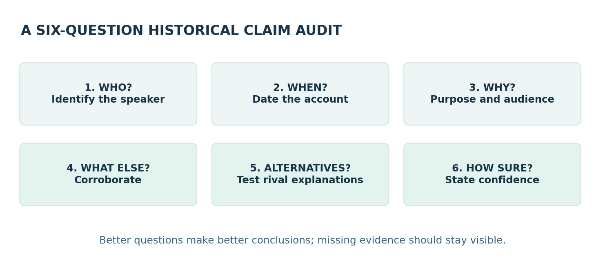

За да видите метода в миниатюрно, представете си някой публикува иск: готино известният средновековен владетел премахва всички данъци за обикновените хора. Вместо да започнем с "истински" или "фалшиви," трябва да определим въпроса. Кой владетел, кой регион, коя дата, кои видове данъци и какво затъват в политическата система? След като условията са точни, разследвайте произхода на вземането. За пръв път ли се появи в съвременен указ, много по-късна хроника, модерна популярна книга или несорсирано онлайн видео?

След това намери най-доброто оцеляло доказателство. Кралската заповед, ако е автентична, може да покаже планирана политика, но да не гарантира изпълнението й. Данъчните сметки могат да разкрият какво всъщност е било събрано, къде са оцелели тези записи. Жалби и правни спорове могат да разкрият изключения, неуспехи при изпълнението и съпротива. Дипломатическата кореспонденция на една съседка може да даде независимо описание, макар и не непременно безпристрастно. Една констатация, че по време на една криза някои от тях са били спрени, би била много различна от всички данъци за постоянно.

<figure class="figure" id="figure-4-8">

<figcaption>Фигура 4.8. Практичен работен процес за разследване на исторически твърдения, без да се преструваме на сигурни. <a class="figure-anchor" href="#figure-4-8" aria-label="Link to this figure">#</a></figcaption>
</figure>

След това формирайте най-предпазливото обяснение, подкрепено от наличните доказателства. Може би владетелят е спрял една такса за определен район за ограничен период от време. Може би един хроникьор празнувал това като щедро правило, а по - късно писателите разширили историята. Може би наличните записи са твърде тънки, за да се отговори. Един дисциплиниран разказ посочва не само заключението си, но и доказателствата, границите на доказателствата и посочването на увереността. Тя не се нуждае от драматична несигурност за всичко; тя се нуждае от прецизност по отношение на твърденията, които остават несигурни.

Тук е практически шест въпроси навик за всяко историческо твърдение: Кой го казва? Кога е създаден този разказ? Какво се е опитвал да направи авторът? Какви независими доказателства съществуват? Какво алтернативно обяснение пасва на доказателствата? Колко сигурни трябва да сме? Повечето обществени исторически недоразумения стават по-лесни за разглеждане, след като тези шест въпроса бъдат направени ясни.
