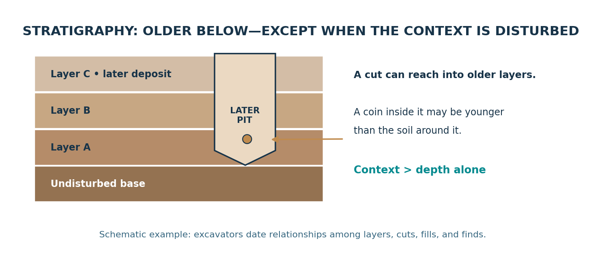

Представи си да копаеш под пода на разрушената къща и да намериш слой пепел, счупена керамика и животински кости. Изкушението е да обявим, че драматичен пожар унищожи цялото селище. Но пепелта може да идва от огнище, местен инцидент или умишлено изгаряне; предметите биха могли да се натрупат в продължение на много години. Археологията превръща физическите следи в историческо разбиране, като записва внимателно контекста, преди да тълкува какво означават останките. Местоположението на обект може да бъде толкова важно, колкото и самият обект.

Фундаментален археологически принцип е стратиграфията. В необезпокоени последователности, по-ниските депозити обикновено се формират преди депозитите над тях. Но това е относителна поръчка, а не гаранция, че всеки по-дълбок обект е по-стар. Погребването на животни, по - късно ями, ремонтите на сгради, ерозията, орането и човешката дейност могат да движат материала наоколо. Дълбокият гроб може да реже по-стари слоеве и да съдържа сравнително скорошни предмети. Монета, паднала в пукнатина, може да мигрира под повърхността. Археологът изследва връзките между слоевете, разрезите, запълванията, стените и предметите, а не само доверчивата дълбочина.

<figure class="figure" id="figure-4-3">

<figcaption>Фигура 4.3. Стратиграфският контекст е по-важен от дълбочината сам по себе си; по-късният разрез може да съдържа по-млади предмети. <a class="figure-anchor" href="#figure-4-3" aria-label="Link to this figure">#</a></figcaption>
</figure>

Археологическият контекст трябва да бъде документиран, защото разкопките са частично разрушителни. След като слойът бъде премахнат, точните му взаимоотношения не могат да бъдат възстановени. Затова археолозите записват планове, снимки, координати, почвени характеристики, находки и откъде идват пробите. Те могат да изследват семена, цветен прашец, въглен, животински зъби, носене на инструменти, микроскопични остатъци или древна ДНК. Всеки тип може да зададе различен въпрос: диета, селскостопанска практика, занаятчийско производство, промяна в околната среда, движение или родство. Резултатите стават по-убедителни, когато се споразумеят за самостоятелно събраните форми на доказателства.

Парче керамика не трябва да носи писмен етикет, за да бъде исторически полезен. Неговата форма, производствена техника, декорация и химически състав може да предложи кога и къде е направена; сравнение с сигурно датирани асемблажи може да стесни възможностите. Внесените обекти могат да показват контакт, но ние не трябва да скачаме от чужд обект на чужда армия или да приемаме търговец, който лично е пътувал по целия маршрут. Стоките могат да си сменят ръцете много пъти. Археологическите доказателства осигуряват ограничения върху обяснението; то не разказва автоматично участващите хора.

Мащабът на една сграда може да предложи организацията на труда и ресурсите, но само размерът не може да ни каже личните вярвания на владетеля. Скелетните доказателства могат да разкрият наранявания или диетичен стрес, без да ни кажат какво точно е казал един човек. Най-силната археология е строга по отношение на тези различия. Когато някой твърди, че един грандиозен артефакт доказва, че цялата цивилизация е основана от външни хора, пауза. Попитайте за стратиграфския контекст, запознанствата, сравнението с местната материална култура и много по-големия модел. Откриването може да има значение. Предложената история все още се нуждае от доказателства.
