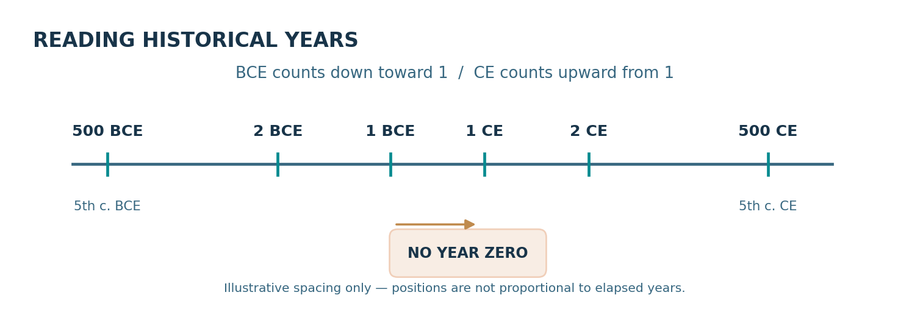

Съвременните глобални референтни книги често използват BCE (........... Годините на BCE броят назад, когато се приближава към конвенционалния старт на ерата; CE години напред. Основно, обикновената историческа година номерация отива директно от 1 BCE до 1 CE. Няма година нула. Това има значение при изчисляване на интервалите, които пресичат границата. От началото на 1 BCE до началото на 1 CE е една година, а не две.

Един конгрес е също така преброяване, а не вълшебна точка в човешките дела. Първото столетие CE е години 1х100, второто е 101х200, а двадесетото - 1901х2000г. В пети век пр.н.е. е 500м 401 г. пр.н.е. Това означава време, по-близо до 500 BCE, а не до 401 BCE. Ако прочетете, че класическият гръцки историк Херодот написал през V век пр.н.е., трябва да си представите 400-те години пр.н.е. и да ориентирате работата му спрямо персийските войни, а не да поемате същия социален свят като Римската империя стотици години по-късно.

<figure class="figure" id="figure-4-1">

<figcaption>Фигура 4.1. BCE/CE историческата нотация не съдържа нула година; схематичното разстояние не е за мащабиране. <a class="figure-anchor" href="#figure-4-1" aria-label="Link to this figure">#</a></figcaption>
</figure>

Цивилизациите са използвали различни календари и много от тях все още използват традиционни или религиозни календари заедно с граждански срещи. Ислямска Хиджри година, например, принадлежи към лунен календар, чиято епоха е свързана с Hijra през 622 CE; защото лунните години са по-къси от слънчевите години, просто изваждайки 622 не дава точна промяна. Рекордът може да датира събитие за четвъртата година на краля, а не за абсолютна CE година. Един древен надпис може да опише празник или сезон, а не преброен ден. Преобразуването на календара често изисква познаване на местната практика, правилата за присъединяване към ЕС и дали датите са включени.

Дори и в рамките на европейската история, обръщането е от значение. Юлианският календар натрупва малка грешка спрямо сезоните; Грегорианската реформа започва през 1582 г. и е приета на различни места по различно време. В местата, където се прави първоначалната смяна през октомври 1582 г., четвъртък 4 октомври е последван от петък 15 октомври. Изминалите дни не изчезнаха от реалността; номерацията скочи. Други региони са се променили по-късно и с различен брой календарни дни. Ако видите две очевидно противоречиви дати за едно и също събитие, проверете дали един използва Джулиан ( гол) и други Грегориански (.Нов гердан) календар.

Познатата Октомври Революция в Русия е настъпила през октомври 1917 г. от Джулиан дати, след което се използва в Русия, но през ноември на съответните Грегориански дати. Името не се е объркало, когато календарът се е променил. Подобно на това една българска историческа дата, запазена от националното честване, може да се нуждае от календарна анотация преди сравнение със западноевропейските дипломатически диспечери. Безопасната практика е да се запише първоначалната дата, както е посочено, използваният календар, ако е известен, и всяка преобразувана дата, а не тихи смесителни системи. Календарът на историка е инструмент за превод и преводите могат да бъдат объркани.
