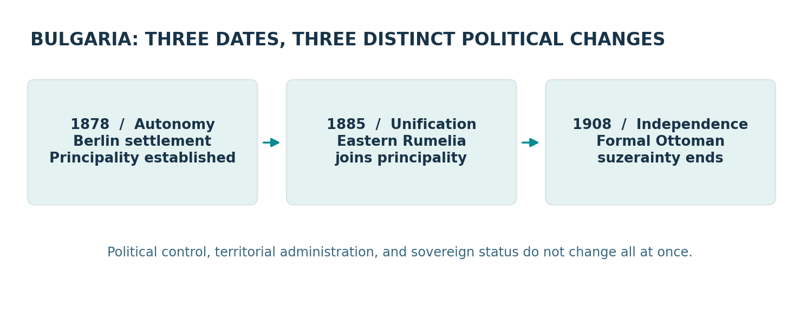

За един познат пример за хронология и политическа интерпретация, разгледайте три дати: 1878, 1885 и 1908. Всички те принадлежат към формирането на съвременна България, но се отнасят до различни видове промени. Третирането им като взаимозаменяеми ще заличи някои от най-важните политически механизми в историята.

През 1878 г. приключи Руско-турската война и беше подписан предварителен мирен договор в Сан Стефано през март. Дипломатическият сетълмент е преразгледан с Договора от Берлин през юли 1878 г., който създава по-малко автономно Княжество България под османско сузерайнство и автономна провинция Източна Румелия с различен правен статут. Други територии остават под пряко османско управление. Точните уговорки бяха продукти на война, преговори и конкурентни интереси с голяма сила. Наречени 1878 г. Освобождението заснема централна тема на българската национална памет, но дипломатическата и законова карта, създадена през тази година, е по-сложна, отколкото само етикетът предполага.

През 1885 г. политическите действия в Източна Румелия и подкрепата на българското княжество доведоха до обединение на двете територии. Събитието промени практическото управление и политическата ситуация, но все още не изтри формалния статут на княжеството съгласно договорната система. През 1908 г. принц Фердинанд обявява пълната независимост на България в Търново и приема титлата цар. Тази декларация сложи край на оставащото официално османско сузерение и последвалите международни преговори помогнаха за сигурното признаване. Прокламацията не беше магически акт, отделен от дипломацията, военната готовност, отоманската политика и интересите на други европейски сили.

<figure class="figure" id="figure-4-7">

<figcaption>Фигура 4.7. Автономността на България (1878 г.), обединението (1885 г.) и независимостта (1908 г.) бяха отделни промени. <a class="figure-anchor" href="#figure-4-7" aria-label="Link to this figure">#</a></figcaption>
</figure>

Защо това е полезен исторически случай? Той изисква няколко отличия: териториален контрол срещу правен статут, действия на националистически движения срещу решения на велики сили, политическа декларация срещу дипломатическо признание и национално възпоменание срещу пълно обяснение. Законният текст може да ни каже какво предвижда един договор; административните записи могат да ни кажат как е управлявана една област; отразяването на вестниците може да разкрие колко различни слушатели разбират събитията. Една по-сложна сметка ги поставя един до друг.

Има и календарна предпазливост. Датите в по-стари български и други регионални записи могат да използват Юлианския календар; по-късните публикации понякога конвертират или отбелязват дати по начини, които читателите трябва да идентифицират изрично. Не предполагайте, че всеки исторически източник използва един и същ месец и ден използва една и съща система за запознанства. Целта ни не е да отричаме важността на честваните събития. Това е да ги видите с достатъчно прецизност, че те се свързват в последователна история, вместо на три изолирани факти.
