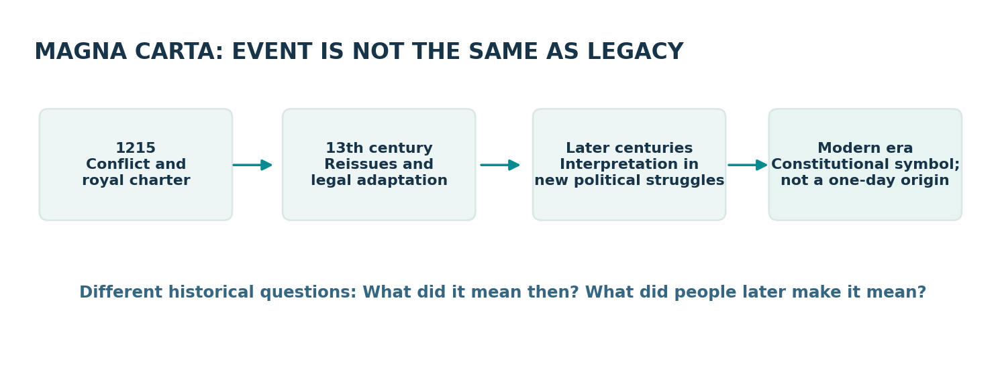

Върни се в Англия през 1215. Цар Йоан се сблъскал с противопоставяне от барони, недоволни от неговото управление и изисквания. Заселването, наречено по-късно Magna Cartan се опита да се справи с оплакванията и да установи ограничения, изразени чрез правните и политически договорености на епохата. Тя не постави Великобритания на непрекъснат прав път към съвременната демокрация. Гражданският конфликт продължи; Хартата беше отменена и по-късно преиздадена в ревизирани формуляри. Фактът, че документът е оцелял политически беше история на по-късно интерпретация, нито едно триумфално подписване.

Започнете с това, което източниците могат да покажат. Оцелелите 1215 оригинали са осезаеми доказателства за текста и разпространението на споразумението. По - късно новите издания показват, че текстът не е бил фиксиран завинаги. Записите на политическите спорове и по-късните правни коментари осветяват как се е променило значението на Хартата. Парламентарните и съдебни традиции се развиват чрез много други борби и институции. Ако искаме да разберем какво са имали предвид хората през 1215 г. с клауза, трябва да я прочетем в контекста на средновековното право и особения конфликт, а не на езика на една въображаема харта за човешките права от двадесет и първи век.

Това не намалява значението му. Един текст може да придобие ново значение, тъй като по-късните поколения избират, разискват и го интерпретират. Идеите относно законното управление и ограниченията върху управниците можели да извлекат легитимност от Магна Карта, дори когато по - късните оратори ѝ дали различни значения от тези, които били познати на първата му публика. Разликата за запазване е между първоначалната функция и последващото наследство. Нито може да замести другия.

<figure class="figure" id="figure-4-6">

<figcaption>Фигура 4.6. Непосредствената политическа цел на Магна Карта и нейното по-късно конституционно наследство се различават. <a class="figure-anchor" href="#figure-4-6" aria-label="Link to this figure">#</a></figcaption>
</figure>

Този случай също дава урок за копията и оригиналите. Ние често се захващаме с един единствен обект, но средновековното административно писане може да произведе няколко копия за разпространение. Доказването, почеркът, печатите и текстовите варианти помагат на учените да възстановят начина, по който тези документи са били направени и предадени. Изложба на музея, която ви кани да се възхищавате на пергамента, може да бъде добра отправна точка; въпросите на историка започват, когато питате защо съществува този екземпляр, коя версия е и как е достигнал архива.
