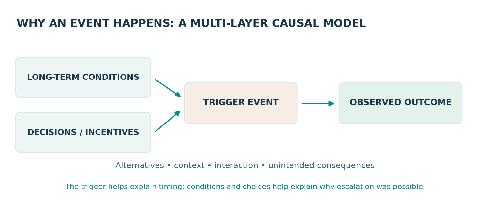

Хората често се питат, какво е причинило войната или защо тази империя рухва и очакват един единствен отговор. Въпреки това историческите резултати обикновено се появяват от няколко различни видове причини. Спусъкът е събитие, което спомага за създаването на криза в движение. Структурните условия са по-бавни сили като институционална слабост, дългосрочно съперничество, натиск върху ресурсите, дълг, технологична промяна или социално неравенство. Човешкият избор определя как участниците реагират в тези условия. Спусък без структурни условия може да обясни времето, но не и по-голямата уязвимост. Структурният контекст без човешка агенция може да направи резултата неизбежен, когато не е бил.

Известен пример е избухването на Първата световна война. Убийството на ерцхерцог Франц Фердинанд в Сараево през юни 1914 г. беше важен спусък. Но по-голямата война не може да бъде обяснена само с убийството. Дипломатическите подравнявания, имперското съперничество, плановете за мобилизация, решенията на лидерите, национализма, страховете от стратегически недостатъци и ескалацията на юлската криза всички навлизат в сериозни обяснения. Историците не са съгласни с относителната отговорност и теглото да се придаде на тези фактори. Това несъгласие не е просто объркване относно това дали убийството се е случило; то засяга сложната причинно-следствена връзка.

Внимателен механизъм за обяснение на причините. Национализмът предизвикал конфликта е твърде неясен, без да се посочва кои организации, идеи, политики или натиск свързани националисти твърдят, че решенията на правителствата и армиите. Слабостта на икономиката, предизвикана от революцията, е непълна, освен ако не покажем как цените, заетостта, данъчните възможности, оплакванията или елитните съюзи влияят на действията. Същият фактор може да има различни ефекти в различни контексти. Икономическата криза може да дестабилизира един режим, като същевременно укрепва подкрепата на друго правителство, ако обществото се довери на своя отговор.

<figure class="figure" id="figure-4-5">

<figcaption>Фигура 4.5. Резултатите произтичат от взаимодействия между дългосрочни условия, избор и задействания. <a class="figure-anchor" href="#figure-4-5" aria-label="Link to this figure">#</a></figcaption>
</figure>

Трите навици подобряват причинно-следствената логика. Първо, различавайки необходимите условия от достатъчните условия: нещо може да е било важно, без само да дава резултат. Второ, помисли върху взаимодействието: провалената реколта може да се превърне в политическа криза, защото правителството не може да внася храна или да реагира невероятно. Трето, попитай какво щеше да се случи, ако едно условие беше различно. Такива въпроси не могат да бъдат изпитани чрез повтаряне на историята, но внимателно ограничените сравнения помагат да се разкрият кои механизми са реалистични. Опасността е да направиш фантазията да звучи като доказателство.

Историята също има неочаквани последствия. Реформите могат да доведат до противопоставяне, победите могат да създадат свръхразширяване и новите комуникационни мрежи могат да засилят движенията, които правителството се стреми да потуши. Винаги отделяй това, което хората, вземащи решения искат от това, което всъщност се е случило. Миналото е пълно с хора, които действат с ограничена информация, в институциите, които не са контролирали изцяло, към резултатите, които не са могли да предвидят напълно.
