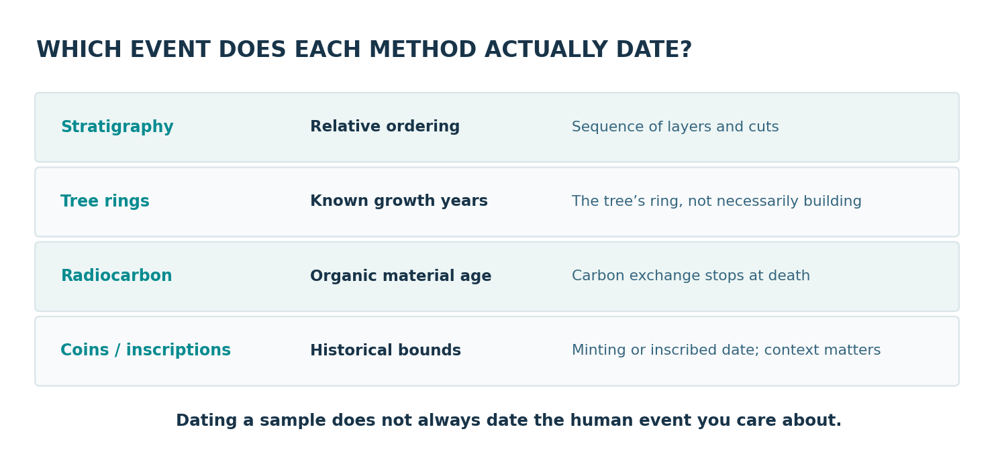

Не всеки исторически въпрос идва с дата, написана в жив документ. Изследователите често изграждат хронология от физически доказателства. Има два различни вида отговори. Относителните запознанства казват, че едно събитие или обект е по-старо от друго. Абсолютните или хронометричните дати оценяват възрастта в години или в рамките на календарен диапазон. Достоверна реконструкция често съчетава и двете.

Дървесен пръстен запознанства, или дендрохронология, съвпадат модели на пръстен растеж сред дървета от припокриващи се възрасти. При благоприятни условия една сигурна последователност може да идентифицира календарната година, в която се е образувал пръстен на дървото. И все пак последният запазен пръстен на дървения материал може да не е годината на отсичане на дървото, ако външните пръстени липсват и повторно използван лъч може да бъде много по-стар от сградата, която го съдържа. Дървото датира от растежа на дървото, а не автоматично от изграждането или изоставянето на обекта. Тази разлика звучи техническо, докато не осъзнаеш, че може да промени цялата историческа времева линия.

<strong>Радиовъглеродна дата</strong> измерва оставащия радиоактивен въглерод-14 в един-жив материал. Когато един организъм спре да обменя въглерод с околната среда, въглерод-14 постепенно се разпада. Неговият физически полуживот е приблизително 5,730 години, което означава, че под най-простия модел около половината от оригиналния радиовъглерод остава след този период. Радиовъглеродните датиращи често помагат за датата на археологическия материал до около 50 000 години, въпреки че практическият диапазон и надеждността зависят от пробата и метода. Тя не може директно да датира обикновен каменен блок само защото блокът е древен; тя понякога може да да датира органичен материал, свързан с конструкцията.

Ето и ключовото усложнение: радиовъглеродното измерване не е автоматично точна дата на календара. Стандартните конвенционални радиовъглеродни възрасти запазват исторически използвания Libby полуживот и експресни години, където по принцип това означава 1950 г., а не текущата година. Атмосферните радиовъглеродни концентрации са се променили с течение на времето, така че измерените възрасти се нуждаят от калибриране спрямо материали от известна дата, като например установени поредици от дървесни пръстени. Несигурност в лабораторните измервания и археологически контекст. Калибриран резултат може да опише един или повече диапазони на вероятностите, а не една точна година.

<figure class="figure" id="figure-4-4">

<figcaption>Фигура 4.4. Техниките за запознанства ограничават различни събития и изискват различни предположения. <a class="figure-anchor" href="#figure-4-4" aria-label="Link to this figure">#</a></figcaption>
</figure>

Срещите могат да се объркат поради разпознаваеми причини. Дърво, изгорено в огнище, може да е дошло от сърцето на вековно дърво: ефектът на старото дърво прави отлежалото израстване по-старо от огъня. Проба, заразена от модерния въглерод, може да изглежда твърде млада. Въздействието на морския или сладководния резервоар може да доведе до заблуждаващи резултати, ако въглеродът в хранителната верига има различна радиовъглеродна история от атмосферата. Ожесточено семе от запечатан контекст може да датира растение с кратък живот, по-точно от въглен от стар дървен материал. Добрите изследователи обясняват избора на проби и вероятните източници на грешки, вместо да ги крият под точно изглеждаща година.

Други техники отговарят на други въпроси. Монети или исторически датирани надписи могат да доставят termini. Термолуминесценция или оптично стимулирана яркост може да се изчисли, когато някои минерали са били последно нагрявани или изложени на светлина при подходящи условия. Геологическите и астрономическите доказателства понякога могат да осигурят допълнителни ограничения. Практичният урок не е да се научи всяка лабораторна техника, а да се запитаме: Какво събитие всъщност е било отлежало производството на обекта, последното му използване, смъртта на организъм, запълването на яма или окупацията на сградата? Резултатът е толкова полезен, колкото тази връзка.
