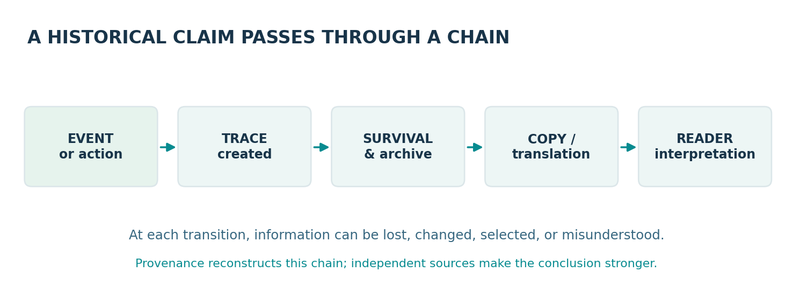

Историята оцелява неравномерно. Каменният надпис може да продължи хилядолетия; разговорът може да изчезне за един час. Дворецът може да остави основи и данъчни документи; ежедневните усилия на работниците могат да оцелеят само косвено, в изхвърлен инструмент, остатъци от храна, погребение или изследване на земята. Писането не беше еднакво достъпно за всички. Онези с власт могат да назначат паметници, да водят бюрократични сметки и да определят кои закони са влезли в официалните архиви. Огромният брой човешки преживявания никога не са били записвани в писмен вид и не могат да бъдат възстановени в същия детайл като делата на владетелите.

Историците наричат оцелелите източници на материали. Писмените текстове са познати: писма, закони, договори, съдебни записи, поеми, дипломатически съобщения, вестници, дневници и счетоводни книги. Но източниците могат да бъдат обекти, кости, сгради, фотографии, пейзажи, езици, устни истории, песни, монети, дървесни пръстени, корабни манифести или цифрови файлове. Източникът не е самото минало. Това е нещо, което оцелява от или коментари за миналото и може да помогне да се отговори на определен въпрос.

<figure class="figure" id="figure-4-2">

<figcaption>Фигура 4.2. От минало събитие до модерна интерпретация: Произходът е верига от решения и оцеляване. <a class="figure-anchor" href="#figure-4-2" aria-label="Link to this figure">#</a></figcaption>
</figure>

Всеки източник има своя собствена история. Писмото е било произведено при определени условия; то може да е било сгънато, доставено, копирано, преведено, повредено, умишлено унищожено или запазено в частен семеен архив. По - късно историкът може да види само печатен откъс. Ако цитат от писмо се появи в съвременна статия, пътят от събитие до претендиране може да тече чрез множество решения: това, което авторът е избрал да напише, какво е оцелял, какво е преписал редактор, как е преведен и какво е подбрал статията. След тази верига се нарича изучаване на произхода и предаването.

Това обяснява защо доказателствата могат да бъдат автентични, без да са пълни. Самото съществуване на кралски данъчен регистър може категорично да показва, че едно правителство се опитало да преброи определени задължения, но не можело автоматично да ни каже всяко задължение, събрано на практика. Военният доклад може да е оригинален и все още съдържа грешни оценки за жертвите. Една стара снимка може да заснеме истински хора и истинска улица, без да докаже надписа, прикрепен към нея. Автентичността установява нещо важно за източника; тя не гарантира истината за всяко твърдение, което извличаме от него.

Също така трябва да разпознаем пристрастието към оцеляването. Материалът, който притежаваме, е резултат както от минали дейности, така и от инцидентите или политиките за съхранение. Ако една библиотека изгори, може да знаем много по-малко за нейното общество, отколкото за друго, което е запазило своите записи. Драматичен паметник може да бъде по - лесен за изучаване от домовете на хората, които са го построили. Историците реагират чрез комбиниране на видове доказателства, търси следи от обикновен живот, разследване кой липсва от архивите, и съпротива аргументи, изградени изцяло върху материалите, които са били най-лесни за съхранение.
