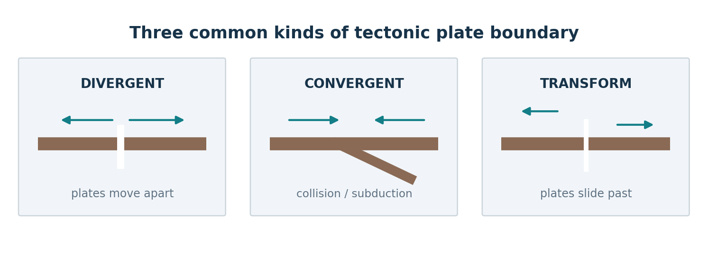

Ако можехме да ускорим геоложкото време, континентите нямаше да стоят неподвижно. Земната твърда външна обвивка е разделена на движещи се тектонични плочи. Плочите могат да се раздалечат на различни граници, да се сблъскат или да се слеят по други граници или да се плъзнат един покрай друг при трансформиращи се граници. Относителните им движения обикновено възлизат на сантиметри годишно. В продължение на милиони години това е достатъчно, за да отвори океаните, да построи огромни планини и да преначертае позициите на континентите. Тектоничните плочи обединяват много наблюдения, включително географските модели на земетресения и вулкани. \[<a href="/005-geography-maps-and-scale/sources/#source-3" class="cite">3</a>\]

На различна граница магмата може да се издигне като отделни плочи; средно-океанските хребети помагат за създаването на нова океанска кора. На една пресечна граница, където океанска плоча се спуска под друга пластина, зоната на субдукция може да генерира мощни земетресения, окопи и вулканични дъги. Където два континента се сблъскват, сгъстената кора може да се издигне в големи планински системи. Хималаите отразяват дългия сблъсък между индийските и евразийските плочи. В една трансформираща граница плочите се плъзгат по-надолу един покрай друг, както и по протежението на секции от системата Сан Андреас Разлом.

Това са модели, не абсолютни правила. Вулканите могат да се появят далеч от границите на табелата, както и подробностите за местната геологична материя. Изригването на вулкан или местоположението на конкретно земетресение не може да бъде предсказано просто като се посочи линия, свързваща плочите. Учените измерват деформацията, сеизмичната активност, геоложката история и много други променливи за оценка на опасностите. Карта на границите на табелата ни казва къде рискът е често концентриран, а не точната дата, когато ще се случи бедствие.

<figure class="figure" id="figure-5-4">

<figcaption>Фигура 5.4. Идеализирани табелки-boundary движения. Истинската геология варира според местоположението и времето. <a class="figure-anchor" href="#figure-5-4" aria-label="Link to this figure">#</a></figcaption>
</figure>

<strong>Топография</strong> означава формата и височината на земята: върхове, хребети, равнини, басейни, долини и склонове. Повишаването влияе на температурата, дренажа, растителността, пътуването и селското стопанство. По-високата земя често е по-хладна, но точната температурна разлика зависи от времето и атмосферните условия. Долините могат да уловят студен въздух или замърсяване. Платото може да предлага терен на високо ниво, докато все още изпитва тънък въздух, сезонен студ или недостиг на вода.

Планините усложняват движението и създават възможности. Пропуска пътищата за концентриране; издигнат терен може да снабдява реки, хранени със сняг и дъждове; стръмните долини могат да дадат потенциал за водноелектрическа енергия, където водоснабдяването и инженерството позволяват това. Андите оформят пейзажите и климата на Западна Южна Америка, докато източноафриканската система Рифт илюстрира как стречингът и разломът могат да образуват долини и езера. Географското ограничение е реално, но обществата реагират с тераси, тунели, пътища, напояване и избор къде да се изгради. Планините не са съдба и не всички планински популации са изолирани.

Естествената опасност е потенциално вреден процес като земетресение, свлачище, наводнение, вулканично изригване, суша или силна буря. Последици от бедствие, когато опасните събития взаимодействат с излагането и уязвимостта. Земетресение в ненаселен район и земетресение под гъсто построен град може да освободи подобна физическа енергия, но причинява много различни човешки загуби. Кодовете на сградите, аварийните системи, бедността, управлението и решенията за използване на земята засягат резултата. Физическата география обяснява опасността; социалната география помага да се обясни кой е наранен.
