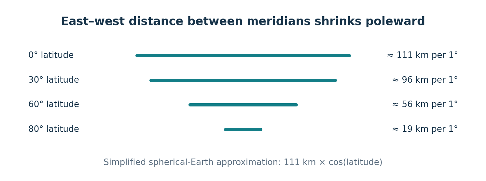

Когато казвате, че едно място е по-северна част от... друга, вие използвате посоката. Когато казвате, че се намира на 42 градуса север, 25 градуса изток, използвате географски координати. Географската ширина измерва ъгловото разстояние на север или юг от екватора, от 0° до 90° в двете посоки. Дължината измерва ъгловото разстояние на изток или запад от меридиана, традиционно измерено през Гринуич, от 0° до 180°. Заедно те предоставят координиращ адрес на или близо до Земята, въпреки че точното местоположение може да изисква също височина и референтна дата.

Линиите на полюсите, които се движат на изток-запад, а линиите на пешеходците, пресичат полюсите. Това създава полезна разлика от разстояние. Степента на географска ширина е приблизително 111 километра, варирайки скромно, защото Земята не е перфектна сфера. В Екватора една степен на дължина също е приблизително 111 километра. С дължина 60°, тя обхваща приблизително половината от това разстояние, защото меридианите се приближават към полюсите. Полезно сближаване за източно-западното разстояние е 111 km × cos(географска ширина) на степен дължина. При географска ширина 60°, cos(60°) = 0,5, достигайки около 55.5 км. На полюсите се срещат всички меридиани. Това е опростено сферично-Earth изчисление, а не заместител на измерване ниво проучване.

<figure class="figure" id="figure-5-3">

<figcaption>Фигура 5.3. Дължината намалява спрямо полюсите; опростени сферични разстояния са показани. <a class="figure-anchor" href="#figure-5-3" aria-label="Link to this figure">#</a></figcaption>
</figure>

За разстояния между широко разделени точки, сферично изчисление на голям кръг използва централния ъгъл между две места. Обичайната оценка е разстоянието, което е средното разстояние на Земята × централен ъгъл в радиани. Средният радиус на Земята е приблизително 6,371 км; действителното проучване използва по-точен елипсоидален модел. Не е нужно да запомните геодезически формули, за да прочетете картата интелигентно. Трябва да разберете защо източно-западната степен не е постоянен брой километри навсякъде.

Датум описва референтния модел и координатната рамка, използвана за определяне на позициите. GPS често използва WGS 84. Две карти, базирани на различни данни могат да поставят една и съща записана координата малко по-различно, което има значение за високопрецизно проучване, инженерство и някои навигация. Обикновените читатели рядко трябва да изчисляват смяната на датума, но те трябва да знаят, че само двойка с дължина на географската ширина не е цялата техническа история.

Координатите също се нуждаят от единици. Нотация 42°30′ с.ш. означава 42 градуса и 30 минути дъга, а не тридесет минути часовник. 60 арку минути правят един градус. Същото местоположение в десетични градуси е 42,5° N. А десетичен като 42.30° не е същото като 42°30′: 0.30° е само осемнадесет арку минути. Това разграничение става критично, когато се преписват координати от един формат на друг.

Компасът на картата, или северната стрелка, описва ориентацията. Магнитен север и вярно (географски) север се различават по местоположение и време зависима магнитна деклинация. Компасът сочи към магнитното поле, а не към географския полюс. Затова професионалната навигация обръща внимание на деклинацията и промените в нея, докато повечето ежедневни цифрови карти тихо управляват посоката за потребителя.
