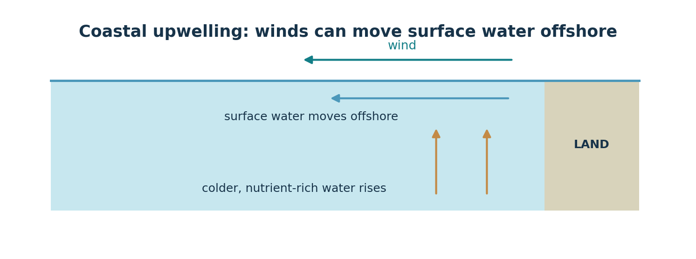

Океаните покриват по-голямата част от земната повърхност и свързват континентите по-често от наземните пътища. Техните повърхностни течения се задвижват до голяма степен от ветрове, с въртенето на Земята и бреговата линия геометрия влияе върху моделите; дълбоко кръвообращение също отговаря на разликите в плътността на морската вода, свързани с температурата и солеността. Потоците пренасят топлина, хранителни вещества и организми и помагат за свързването на локалния климат с планетарните процеси. \[<a href="/005-geography-maps-and-scale/sources/#source-5" class="cite">5</a>\]

Представете си да стоите на брега, където ветровете отдалечават повърхностните води от брега. По-студена, богата на хранителни вещества вода може да се издигне от дълбочина, за да я замени. Това е крайбрежно обитаване, важна причина някои морски региони да подкрепят изключително продуктивния риболов. Части от източната част на Атлантическия океан и източната част на Тихия океан са известни с тези системи. Брегът може да бъде близо до пустинята и все още поддържа богат морски живот, защото валежите на сушата и хранителните запаси в морето отговарят на различни процеси. \[<a href="/005-geography-maps-and-scale/sources/#source-6" class="cite">6</a>\]

<figure class="figure" id="figure-5-8">

<figcaption>Фигура 5.8. Концептуална схема: офшорният повърхностен транспорт позволява по-дълбока вода да се издига. <a class="figure-anchor" href="#figure-5-8" aria-label="Link to this figure">#</a></figcaption>
</figure>

Исторически, моретата са били бариери и магистрали. Средиземно море свързва три континента и подкрепя търговски светове с пристанища, маршрути и културни обмени. Индийският океан позволявал на моряците да използват сезонни ветрове, свързващи Източна Африка, Арабия, Южна Азия и Югоизточна Азия в продължение на векове. По - късно Атлантическият океан станал център на големите търговски, колониални и принудителни мрежи за миграция, включително трансатлантическата търговия с роби. Морският достъп създава възможности, но политическата сила, корабите, трудовите системи, финансовите институции и принуда определят какво правят хората с тях.

Тесен пролив или канал може да бъде точката на задушаване, място, където много пътища преминават през ограничен коридор. Протокът Малака свързва големи морски пътища в Индийския океан и Югоизточна Азия; Суецкия канал свързва Средиземно море с Червено море; Панамският канал се присъединява към Атлантическия и Тихия океан на Централна Америка; турските проливи свързват Черно море със Средиземно море през Мармара и Егейско море. Такива места могат да намалят времето за пътуване, като концентрират уязвимостта. В някои случаи съществуват алтернативни маршрути, но те често налагат по-дълги пътувания или по-високи разходи. \[<a href="/005-geography-maps-and-scale/sources/#source-7" class="cite">7</a>\]

Не приемай, че всеки кораб използва точно един маршрут или че част от търговията на точката на задушаване остава постоянна. Доставка зависи от цените на горивата, размера на корабите, геополитическите условия, застраховката, дълбочината на водата, времето и пристанищните съоръжения. Трайното географско прозрение е за формата на мрежата: когато много връзки зависят от малък брой пасажи, смущенията в тези пасажи могат да се разпространяват далеч отвъд местния регион.
