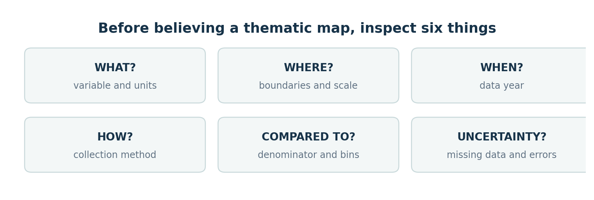

Тематична карта показва разпределението на един предмет: гъстота на населението, валежи, безработица, език, изборни резултати или нещо друго. Цветовете му може да са завладяващи, но картата има много скрит статистически избор. Една хоропултна карта оцветява географски единици според стойностите на средните доходи, например. Площи с повече земя заемат по-очевидно пространство дори когато те съдържат по-малко хора. Това може да доведе до слабо населени райони да доминират карта, докато гъст град заема само една малка кръпка.

Ако оцветите провинциите чрез общи кражби, големите или населяващите провинции може да изглежда имат повече престъпления само защото съдържат повече хора. Цените на всеки жител могат да отговорят на друг въпрос; карта на местните горещи точки може да разкрие различия в провинциите. По същия начин карта на населението, оцветена от броя на жителите, не е същата като картата за плътността на населението. Винаги питай за знаменателя.

Две технически идеи си струва да се признаят. модифицираният проблем с ареалната единица (MAUP) означава, че статистическите модели могат да се променят, когато данните са групирани в различни географски единици по размер или по различен начин. Екологичната заблуда настъпва, когато средната връзка, наблюдавана за даден регион, се приписва неправилно на индивидите вътре в него. Ако богатите райони имат високи цени на използване на обществения транспорт, не следва, че най-богатите хора използват обществен транспорт най-често. Регионалните модели не създават автоматично индивидуално поведение.

Картата трябва също да има легенда, дата, източник на данни и за предпочитане ясна бележка относно несигурността. Класовите прекъсвания могат да преувеличават или прикрият вариации; две карти на идентични данни могат да изглеждат различни, ако един използва равни интервали и друг използва quantiles. Цветовете могат да означават морални решения, когато червеното се използва за годнене и зелено за добро, без обяснение. Прецизно изглеждаща карта може да се основава на оценки, непълни проучвания или спорни класификации. Грамотността на картата е отчасти числова грамотност, свързваща тази глава с глави 3 и 6.

<figure class="figure" id="figure-5-9">

<figcaption>Фигура 5.9. Шест въпроса за проверка на доказателствата и визуалния избор зад тематични карти. <a class="figure-anchor" href="#figure-5-9" aria-label="Link to this figure">#</a></figcaption>
</figure>

Съвременните географски информационни системи (ГИС) съчетават слоеве от пространствени данни, за да анализират въпроси като експозиция на наводнения, време за пътуване до болниците, промяна на местообитанията, инфраструктурни нужди и тенденции в регионалното население. Дистанционното наблюдение от сателити и самолети осигурява наблюдения на земната покривка, температурата на морската повърхност, растителността, леда, топографията и други характеристики. Тези наблюдения са мощни, но изискват интерпретация: сателитното изображение не е вълшебно доказателство за това какво е причинило промяна на земята. Сензорите имат резолюция и грешка; облаците замъгляват оптични изображения; класификациите могат да объркат категории; въпроси, свързани с валидирането.

Окончателното предупреждение засяга картите на спорните граници. Различните институции могат да използват различни представителства. Отговорният изследовател проверява целта, издателя и правните възражения, особено при обсъждане на суверенитета. Когато съществува спор, друга точна физическа карта не следва да се превръща в безусловни политически претенции.
