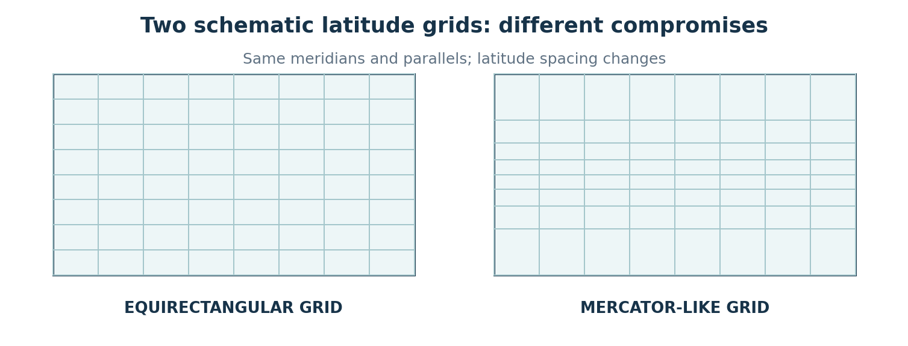

Представете си да обелите кожата от портокал и да я натиснете, без да я разтягате или разкъсвате. Не можеш. Сфероподобната повърхност не може да бъде сплескана без изкривяване; картографите са изправени пред същия проблем със Земята. Проекцията на картата е математическо правило, което поставя позиции върху извита повърхност върху плосък лист или екран. Различни проекции запазват различни свойства. Изборът не е само естетически: той засяга това, което сравнения зрителите намират интуитивен.

Познат цилиндричен проекция Mercator е conformal: в достатъчно малки мащаби, тя запазва местните ъгли и форми. На него се появява линия от постоянен компас, носеща въжена линия, която е полезна в традиционната навигация. Но проекцията увеличава все повече райони, докато се движите към високи ширини. Гренландия може да изглежда огромна в сравнение с Африка, въпреки че действителната площ на Африка е около четиринадесет пъти по-голяма от тази на Гренландия. Самите полюси не могат да бъдат показани на крайни позиции на стандартна карта Mercator. \[<a href="/005-geography-maps-and-scale/sources/#source-1" class="cite">1</a>\]

Проекцията на равни площи дава различно обещание: равните повърхностни площи на Земята заемат равни зони на картата. Тя жертва някои форми и ъгли, за да постигне това. Глобусът най-добре представя относителните форми и области на цялата планета, но един глобус не може лесно да покаже всяко местоположение едновременно. Компромисна проекция, като например Робинсън или Уинкел Трипел, се опитва да балансира изкривяванията без перфектно запазване на нито един имот по целия свят. Проекцията на азимутал може да запази посоките от центъра му; конкретни равностранни проекции запазват разстояния по определени линии, не всички възможни маршрути. Въпросът никога не е по-добре коя карта е перфектна?., но коя карта е подходяща за задачата ми? \[<a href="/005-geography-maps-and-scale/sources/#source-1" class="cite">1</a>\]\[<a href="/005-geography-maps-and-scale/sources/#source-2" class="cite">2</a>\]

<figure class="figure" id="figure-5-2">

<figcaption>Фигура 5.2. Две схеми за географска ширина, илюстриращи защо плоската карта трябва да избира своите изкривявания. <a class="figure-anchor" href="#figure-5-2" aria-label="Link to this figure">#</a></figcaption>
</figure>

Практическото погрешно схващане е, че права линия на картата на обикновения свят винаги е най-краткият път. По глобус, най-краткият път на повърхността следва голям маршрут. Когато самолетите прекосят северната част на Атлантическия океан, извитите им пътеки на плоска карта могат да бъдат по-къси от визуално правия път. Междувременно права линия на румба на карта Mercator има постоянен лагер, но обикновено не е най-краткият път, освен в определени случаи. Дори съвременните маршрути могат да се отклоняват от големите кръгове поради ветрове, ограничено въздушно пространство, безопасност, време, разходи и летищни ограничения.

Проекцията не е единственият избор, който се крие в картата. Картографът избира също център, ориентация, мащаб, дата, класификация, легенда и коя информация да пропуснете. На север картата е конгрес, а не природен закон. Карта, съсредоточена върху Атлантическия океан, прави Европа и Америка да изглеждат видни; тихоокеанската карта подчертава връзките между Азия и Океания. Една политическа карта подчертава държавите; една релефна карта подчертава издигането; транзитната карта може умишлено да изкриви разстоянията, така че станциите и обмените да останат разбираеми.

Картографската грамотност изисква нежно подозрение: каква е била тази карта, за да покаже какво крие и може ли различна проекция или рамка да промени впечатлението на читателя? Картата може да бъде точна за целта си, без да е неутрална картина на всичко.
