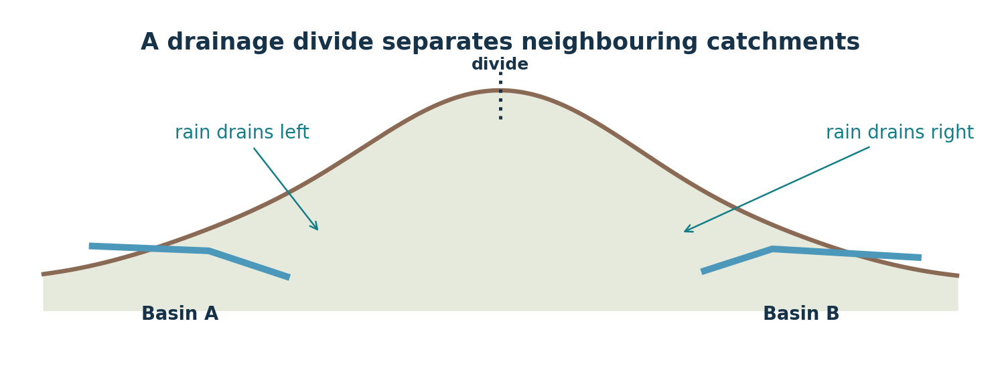

От космоса речните системи приличат на разклонителни мрежи. Дъждът или снеговалежът се събират по каналите, текат надолу под гравитацията, присъединяват се към притоците и често достигат езеро или море. Районът, който се оттича към общ отдушник, е водосборен басейн, наречен също дренажен басейн или водосбор. Отводняването разделя съседни басейни, често покрай по-високите хребети. Следователно билото, разделящо две долини, може да реши коя река в крайна сметка ще получи техните валежи.

<figure class="figure" id="figure-5-5">

<figcaption>Фигура 5.5. Дъждът, падащ от противоположните страни на дренажното деление, може да навлезе в различни водосборни басейни. <a class="figure-anchor" href="#figure-5-5" aria-label="Link to this figure">#</a></figcaption>
</figure>

Вода оформя пейзажи чрез ерозия (премахващ се материал), транспорт (изнася се) и отлагане (отлагане). Бързодвижещите се води могат да подкопаят долините; по-бавните участъци могат да отлагат седиментите. Реката може да построи наводнение от плодородни седименти, но същата равнина е изложена на наводнения. Делта се образува, където седиментът се натрупва близо до устата на реката при подходящи условия. Не всяка река образува голяма делта: вълни, течения, седименти, условия на морското равнище, човешки язовири и други фактори могат да предотвратят или променят отлагането.

Реките имат значение за човешките общества, защото те осигуряват вода, плодородни наводнения, риболов, транспортни коридори, а понякога и енергия. Сезонният режим на наводненията в Нил помогна за поддържането на историческото селско стопанство, въпреки че хората също се нуждаеха от организация на труда, съхранение, напояване и политически институции. Системата Ганг-Брахмапутра-Мегна оформя живота през Южна Азия чрез вода, плодородни седименти и рискове от наводнения. Дунав свързва множество централно-югоизточни европейски пейзажи, преди да достигне Черно море. Огромният басейн на Амазонка поддържа огромна екологична система, чиито гори, почви, води и общности са дълбоко свързани.

Реката не е автоматично лесна магистрала. Рапидите, сезонните промени, водопадите, плитките пътища и смяната на каналите могат да възпрепятстват транспорта. Лодките могат да се движат по различен начин нагоре и надолу по течението. Мостове и плавателни канали изискват инвестиции. Реката може да свързва пазарите в рамките на един век и да загуби относително значение за транспорта след изграждането на железницата, като същевременно осигурява питейна вода, напояване и екологични услуги.

Водата създава политически въпроси, защото басейните и държавите рядко се подреждат перфектно. Потребителите нагоре по веригата и ползвателите надолу по веригата може да имат различни опасения относно язовири, напояване, замърсяване, водноелектрическа енергия и суша. Всяка страна има законни нужди, които не могат да бъдат разбрани само като гледате пътя на реката. Помислете за системата Нил: водите й преминават през няколко страни и климати, а решенията относно използването на водата включват хидрология, население, история, инфраструктура и дипломация. Географията обяснява взаимозависимостта; тя не диктува справедливо политическо споразумение.

Подземната вода е толкова важна, колкото и видимите реки в много региони. Водата, държана в пори и фрактури под повърхността, може да доставя кладенци и земеделие. Водопадът е геоложка формация, която може да съхранява и предава използваемата подпочвена вода. Някои водни слоеве се презареждат бавно; извличането на повече, отколкото скоростта на попълване може да намали водните маси. Помпването може да даде възможност за отглеждане в сух регион, като същевременно се създават дългосрочни разходи за съседните общности и по-късните поколения. Следователно картата на реките е само част от водната география на дадена територия.
