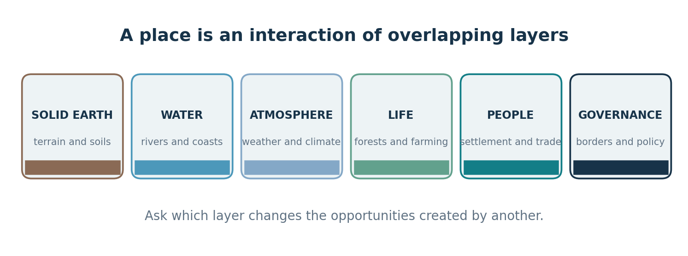

<strong>Физическа география</strong> изследва формите на земята, водата, климата, почвите, екосистемите и процесите, които ги създават и променят. Човешката география изследва селищата, населението, миграцията, езика, икономическата активност, политическите територии и маршрутите, по които обществата обменят стоки и идеи. Нито може да се разбере напълно в изолация. Реката е хидрологична система, екологично местообитание, източник на питейна вода, транспортен коридор, а понякога и правна граница. Една функция може да бъде проучена чрез няколко лещи, всяка разкрива различен вид факт.

Географите също различават пространството от мястото. Пространството ни помага да опишем разстоянието, разпределението и взаимоотношенията между местата. Мястото добавя специфичните характеристики и човешки значения, свързани с дадено място: позната планинска долина, свещен град, производствен център или граница. Същото село може да бъде място на памет за своите жители и точка в набор от регионални населението. И двете описания са валидни за различни въпроси, но втората не е заместител на първата.

Ключовата дума е мащаб. По скалата на една улица едно ново пешеходно кръстовище може да промени начина, по който хората достигат до магазин. В мащабите на дадена държава железопътните мрежи могат да повлияят върху това кои региони привличат инвестиции. В мащабите на континента валежите и планинските системи обясняват широките модели на селското стопанство. В планетарната скала океаните регулират огромните потоци топлина и влага. Една генерализация, която работи в един мащаб може да се разпадне на друг. Казвайки, че Средиземно море има сухи лета могат да опишат широк климатичен модел, без да предполагат, че всяка долина и хълм преживява едно и също време.

Географията също се променя с времето. Речните канали мигрират; бреговите линии се разпадат; климатът варира; градовете се разширяват; политическите граници се договарят. Картата е картина от определен момент, изградена от наблюдения и конгреси. Тя не може да съдържа всички възможни фючърси. Една елегантна атлас страница може да покани погрешното предположение, че светът винаги е изглеждал по този начин.

Полезният умствен модел е купчина слоеве: геология, издигане, вода, климат, растителност, население, използване на земята, транспортни мрежи, институции. Попитайте как един слой променя значението на друг. Една плоска равнина може да поддържа механизирано земеделие, където почвите, водата и собствеността го позволяват. Същата плоскост може да направи и място, уязвимо от наводнения. Никоя географска характеристика не е просто предимство или недостатък извън конкретен човешки въпрос.

<figure class="figure" id="figure-5-1">

<figcaption>Фигура 5.1. Географско проучване преминава през свързани физически и човешки слоеве. <a class="figure-anchor" href="#figure-5-1" aria-label="Link to this figure">#</a></figcaption>
</figure>
