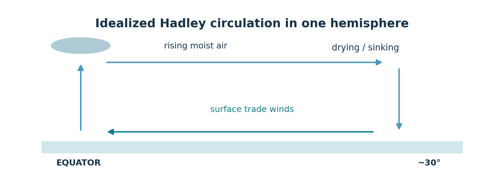
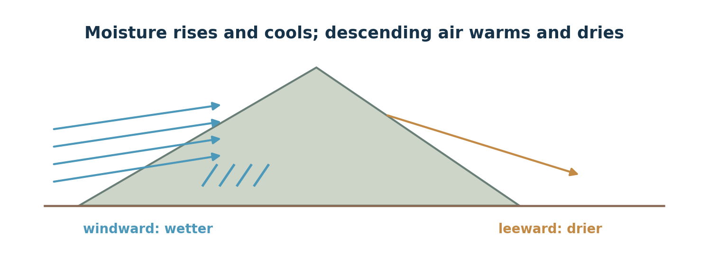

Земята не е равномерно загрята. Поради извитата си форма и аксиалния наклон, ъгълът и продължителността на слънчевата светлина варират според ширината и сезона. В общи линии екваториалните региони получават повече пряка слънчева енергия през годината, докато високите географски ширини имат много по-големи сезонни разлики в дневната светлина. Сезоните са причинени главно от наклона на земната ос спрямо орбитата й, а не от това, че Земята е по-близо до Слънцето през северното лято. Двете полукълба преживяват противоположни сезонни фази.

<strong>Времето</strong> е краткосрочното състояние на атмосферата: днешната температура, облак, дъжд, вятър и налягане. Климатът е статистически модел и диапазон на времето в продължение на по-дълги периоди, често обобщени с помощта на мулти-декадни средни стойности, докато също учи крайности. Студеният вторник не опровергава дългосрочната тенденция на затопляне, а горещата седмица сама по себе си не създава такава. Разликата е между определено събитие и разпределение на събитията във времето.

Близо до екватора топлият влажен въздух често се издига в зони с ниско налягане, изстива и произвежда значителни валежи. На по-високи нива, част от този въздух се движи напред, в крайна сметка се спуска в субтропическите региони. Тази идеализирана тропическа циркулация се нарича клетката на Хадли. В съчетание с глобалното кръвообращение, въртенето на Земята, различията между сушата и океана, това помага да се обясни защо много екваториални региони са влажни и много субтропични райони имат сух климат. Действителната атмосфера е далеч по-объркана от спретната диаграма; дъждовните колани се променят с сезоните и местната география. \[<a href="/005-geography-maps-and-scale/sources/#source-4" class="cite">4</a>\]

<figure class="figure" id="figure-5-6">

<figcaption>Фигура 5.6. Опростена циркулация на клетките на Хадли. Истинските глобални атмосферни потоци са по-сложни. <a class="figure-anchor" href="#figure-5-6" aria-label="Link to this figure">#</a></figcaption>
</figure>

Мусонът по принцип е сезонно обръщане или голяма сезонна промяна в атмосферния поток, което често води до силен сух сезонен модел. Това не е просто синоним на тежкия дъжд. Южна и Източна Азия съдържат добре познати мусонни системи, но мусонното кръвообращение засяга и други региони. Земята и океанската топлина с различна скорост, а големите атмосферни модели се движат сезонно. Земеделските календари, резервоарите, планирането на наводненията и градския дренаж зависят от тези повтарящи се модели.

Планините добавят дъждовния ефект. Влажният въздух, приближаващ обсега, може да се издигне, охлади и кондензира, което води до валежи по склона на вятъра. Въздухът се спуска от лявата страна има тенденция да се затопля и става по-сух в относително изражение. Резултатът зависи от ветровете, температурата, наклона, влагата и климатичните модели; не всяка планина произвежда еднакво силна дъждовна сянка. По този начин планинските вериги могат да поставят сравнително влажна и суха среда доста близо една до друга.

<figure class="figure" id="figure-5-7">

<figcaption>Фигура 5.7. Концептуален механизъм за дъждовна сянка през планинска бариера. <a class="figure-anchor" href="#figure-5-7" aria-label="Link to this figure">#</a></figcaption>
</figure>

<strong>Височина</strong> може да направи висок тропически град по-хладен от крайбрежна низина с подобна ширина. Континенталността отличава районите, модерирани от близките големи водни басейни от континенталния интериор с по-големи сезонни температурни диапазони. Големите езера също могат да усреднят местния климат. Океанските течения пренасят топлина, влияят върху температурата на морската повърхност и могат да повлияят на мъглата, валежите и морските екосистеми. Гълфстрийм и по-широкото движение в северната част на Атлантическия океан допринасят за климатичния модел на Северния Атлантик; точният климат в града също зависи от ветровете, неговата географска ширина, височина и геометрията на сушата. \[<a href="/005-geography-maps-and-scale/sources/#source-5" class="cite">5</a>\]

Климатичните категории, включително тропически, сухи, умерени, континентални и полярни групи, са по-скоро полезни резюмета, отколкото твърди кутии. Преходната зона може да премине през няколко дузини километра или с височина. А климатът може да се промени с векове или десетилетия. Разбирането на едно място изисква както дългогодишните климатични тенденции, така и натиска, който в момента ги променя.
