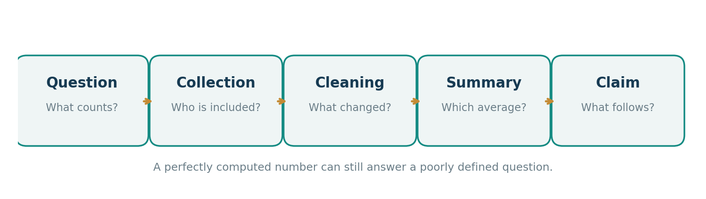

Помислете за изявлението, средно магазина продава 200 елемента на ден. Преди да попитате дали 200 са точни, попитайте: какво се брои за магазин, предмет и ден? Един пакет бисквити брои ли се като един артикул, или е част от съставна опаковка? Включени ли са затворените недели? Магазините еднакво претеглени ли са, независимо от размера? Означава ли цифрата средната стойност на средните стойности за отделните магазини или общо продадените стоки, разделени на всички работни дни? Отговорите могат да променят резултата драматично, без да променят нито една първоначална сделка.

Единица наблюдение е нещото, представено от един ред данни: един клиент, домакинство, покупка, страна, училище или ден. Променливата е характеристика, наблюдавана за тази единица: нейната цена, доход, тестова оценка, дата или категория. Населението е пълната група, за която се задава въпрос. Проба е всъщност наблюдаваната подмножество. Параметър описва популацията, докато статистически обобщава пробата. Тези отличия могат да звучат абстрактно, докато проучване за удовлетвореност на клиентите на 50 посетители се рекламира като гледка към цял град.

Не всички данни имат еднаква структура. Категоричните данни поставят наблюденията в групи, като например метод на плащане или предпочитан транспорт. Числени данни записват количества, като време за пътуване или продадени килограми. Някои количества се броят; други са измервания на континуум. Ординалните категории са много недоволни, неудовлетворени, неутрални, доволни, много удовлетворени, но пропуските между тях не трябва да бъдат равни. Замяната на тези отговори с номера 1 по 5 прави изчисленията удобни; това не магически доказва, че психологическото разстояние от 1 до 2 е равно на това от 4 до 5.

Определението има най-голямо значение, когато данните водят до решение. Правителството се нуждае от последователна дефиниция за това кой е считан за работещ. Следенето на училището трябва да реши дали ученик, който пристига късно, се брои за настояще. Търговецът на дребно, разследващ "недостиг" трябва да разграничи приходите, брутния марж, оперативната печалба и паричните средства. Това не са само технически подробности под заглавието. Те определят за какво е заглавието.

<figure class="figure" id="figure-6-1">

<figcaption>Фигура 6.1. Пътуването от наблюдение до заглавие съдържа решения на всеки етап. <a class="figure-anchor" href="#figure-6-1" aria-label="Link to this figure">#</a></figcaption>
</figure>
