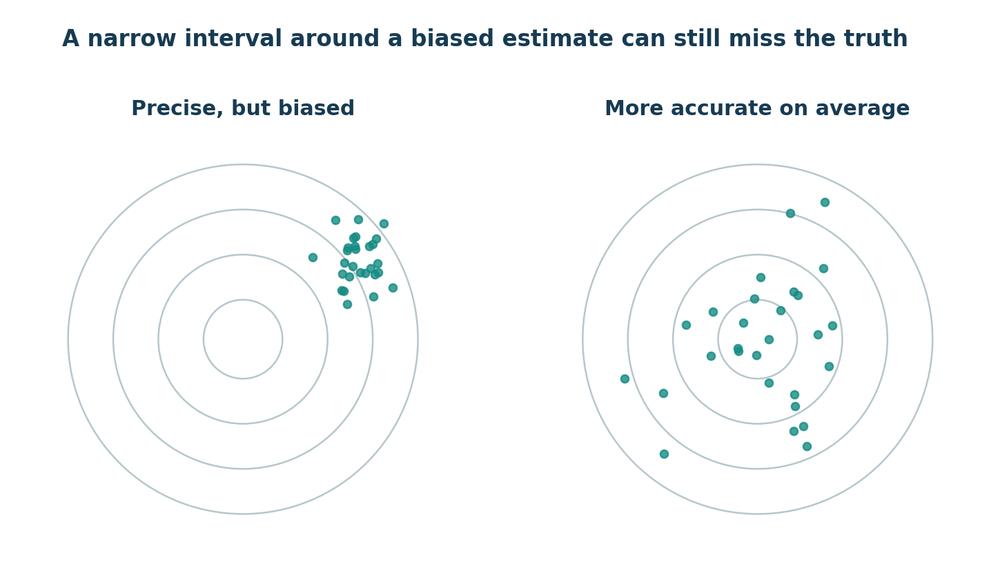

Да предположим, че изтеглите проста случайна извадка от 400 гласоподаватели от голямо население и откриете, че 50% подкрепят предложение. Приблизителна стандартна грешка за дадено съотношение е корен квадратен от p(1−p)/n. С p = 0,50 и n = 400, което е 0,025. Приблизителен 95 процента интервал с 1,96 стандартни грешки е следователно 0,50 ± 0,049, или около 45,1% до 54,9%. Това изчисление предполага условия, при които нормалното сближаване е подходящо и не отчита проблеми с покритието, липса на отговор, формулировка на въпроси, клъстериране или други ефекти върху дизайна.

Ако четворим простия случаен размер на пробата до 1600 при сравними условия, приблизителният марж се свива наполовина до 2,45 процентни пункта. Това кв. кореново правило е ценна проверка на реалността: удвояването на размера на пробата подобрява случайната прецизност, но не намалява наполовина маржа. Едно очевидно огромно проучване може все още да бъде предубедено, ако грешните хора са подходящи или желаят да отговорят.

Често пъти 95% интервал на увереност е неправилен. След като интервалът е изчислен по фиксиран модел, неизвестният параметър на популацията се третира като фиксиран, а не случайно движещ се номер. 95 процента се отнася до дългосрочното представяне на процедурата за изграждане на интервал: през повторенията, приблизително 95 процента от тези интервали биха съдържали истинския параметър, ако предположенията са налице. Това не означава, че параметърът има 95% вероятност да лежи в този конкретен изчислителен интервал. Bayesian методи могат да отговорят различно рамкирани въпроси вероятност за параметри, но изискват изрични предварителни и модел предположения.

Интервалът не е лек за дефектни данни. Тесен диапазон около оценка от селективно вербувана проба може да създаде опасна илюзия за сигурност. В статистическата работа точността и прецизността са различни добродетели. Аналогията на дартсборда е полезна: стегнат куп от стрелички може да седи далеч от центъра. Ако процесът на вземане на проби е предубеден, събирането на повече стрелички в същия грешен ъгъл не подобрява точността.

<figure class="figure" id="figure-6-7">

<figcaption>Фигура 6.7. Концептуално изобразяване на прецизност спрямо точност; ниската променливост не е достатъчна, ако оценките са систематично предубедени. <a class="figure-anchor" href="#figure-6-7" aria-label="Link to this figure">#</a></figcaption>
</figure>
