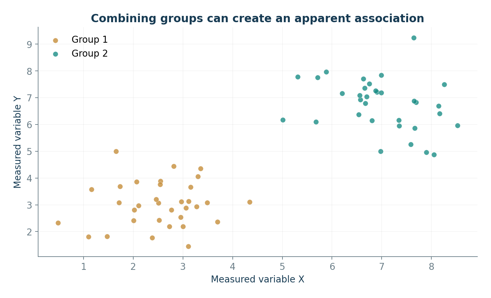

Да предположим, че градовете с повече библиотеки също имат по-високо средно образование. Едно от обясненията е, че библиотеките помагат на хората да учат. Друго е, че по-богатите градове могат да си позволят повече библиотеки и също са склонни да имат образователни предимства. Или и двата пътя може да имат значение. Наблюдаваната корелация ни показва, че две променливи се променят по някакъв модел. Той сам по себе си не идентифицира посоката или източника на причинно-следствена връзка.

А confounder влияе както променливи и създава или замъглява асоциация. Сладолед продажби и плувни произшествия могат да се повишат в топло време, но времето и повече време прекарано плуване предлагат обяснение, което не изисква сладолед, за да предизвика инциденти. Внимавайте да не разглеждате примери като доказателство, че всяка връзка е безсмислена. Сдружението може да бъде ценна следа, прогностична черта или част от причинно-следствена верига; неговото тълкуване зависи от допълнителни доказателства.

Обикновеният коефициент на корелация Pearson, написан r, варира от −1 до +1 за набор от данни за недегенерация. Стойности в близост до +1 показват силна положителна линейна асоциация, тези в близост до −1 силна отрицателна линейна асоциация, и стойности близо до нула малка линейна асоциация. Една извита връзка може да бъде силна, дори ако r е малка. Аутлиерите могат да повлияят R рязко. Корелацията от +0.8 не означава, че се обясняват 80 процента от случаите и тя не установява причина за това. В прост модел на линейно отклонение с прехващане и един предсказуем, r2 е делът на вариацията в реакцията, която се отчита от монтираната линейна зависимост в пробата; това е по-тесен и по-технически извод.

А скатерплот може да изложи характеристики, които един коефициент крие. Помисли върху наблюденията, описващи времето за упражнения и пулса на почивката, или образованието и доходите. Няколко изключителни точки, нелинейни криви и отделни купове могат всички да променят значението. Да искаш да видиш сюжета често е по-полезно от това да поискаш друго място след десетичната запетая на r.

<figure class="figure" id="figure-6-5">

<figcaption>Фигура 6.5. Две измислени групи могат да покажат цялостен модел, доста различен от модела в която и да е група. <a class="figure-anchor" href="#figure-6-5" aria-label="Link to this figure">#</a></figcaption>
</figure>

Друга опасност е екологичната заблуда: ако приемем, че групова връзка се прилага за отделни членове. Ако регионите с повече висшисти гласуват по различен начин, не следва всеки завършил да гласува в посока, свързана с тези региони. Данните на равнище зона описват районите. Заключенията относно физическите лица изискват подходящи индивидуални доказателства. Въпросът се появява в картите на престъпността, здравето, доходите и изборното поведение, където визуално силни модели могат да насърчат неоправдани лични решения.
