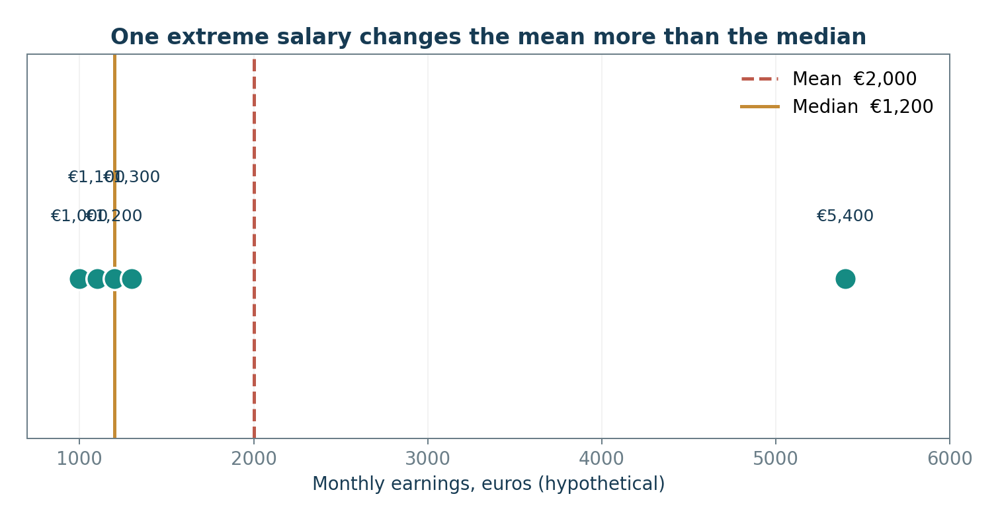

Да предположим, че петима измислени служители печелят месечни суми от 1000 евро, 1100 евро, 1200 евро, 1300 евро и 5 400 евро. Общата сума е 10 000 евро, така че средната аритметична стойност е 2000 евро. Средната стойност на централното наблюдение след сортирането е 1200 евро. И двете са прави. И все пак изречението по средностатистическия служител печели € 2000 може да създаде подвеждаща снимка на това, което повечето служители вземат у дома. Четири от петте печелят значително по-малко. Режимът, най-честата стойност, не помага тук, защото всяка сума се появява веднъж.

Защо винаги не използвате медианата? Защото различните въпроси изискват различни обобщения. Ако работодателят трябва да финансира общите заплати, средната стойност е пряко свързана с общата сума. Ако бъдещият служител иска да разбере типичната заплата на работника, медианата може да е по-информативна. За домакинствата богатство и доходи, силно десните разпределения могат да доведат до големи разлики между средната и медианата. Разпределението е изкривено, когато едната опашка се простира по-далеч от другата; голямата дясна опашка може да изтегли средната нагоре.

Дори медианата крие важна информация. Да разгледаме две села със среден месечен доход от 1200 евро. Първо, доходите се струпват между 1100 евро и 1300 евро. Във втория, много хора печелят 600 евро и други 2500 евро, но средното наблюдение все още е равно на 1200 евро. Същата медиана не означава същата степен на неравенство или сигурност. Един добър обобщение посочва центъра и нещо за разпространението около него.

Среднопретеглената стойност е подходяща, когато групите допринасят за различен брой наблюдения. Ако Store A продава 10 артикула на средна цена от 2 € и Store B продава 90 на средна цена от 4 €, общата стойност на акцията е 10 × €2 + 90 × €4)/100 = €3.80. Просто осредняване на магазините "два означава доходност €3, което описва различно изчисление: средната стойност на произволно избран магазин на средна цена, когато и двата магазина имат еднакво тегло. Нито едно от изчисленията не е аритметична грешка, но само един отговаря на въпроса.

<figure class="figure" id="figure-6-2">

<figcaption>Фигура 6.2. В тази хипотетична група, висока стойност дърпа средната нагоре, докато медианата остава близо до повечето наблюдения. <a class="figure-anchor" href="#figure-6-2" aria-label="Link to this figure">#</a></figcaption>
</figure>
