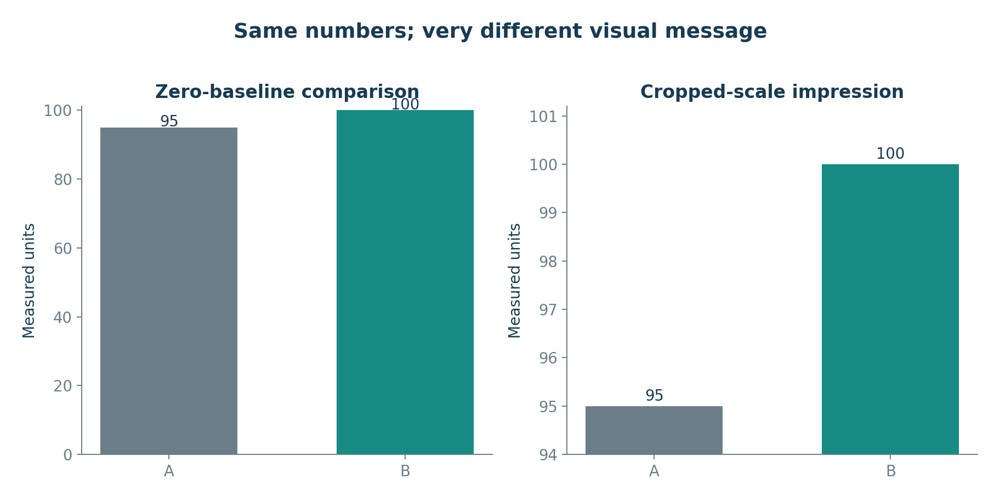

Картата не е просто декорация около иск. Това е машина за насочване на вниманието. Бар диаграми се сравняват количества чрез дължини; техните барове обикновено трябва да започнете с една значима нула базова стойност, когато зрителите ще четат дължина като магнитуд. Линиите графики показват поръчана промяна през времето, и nonzero вертикална ос понякога може да помогне за разкриване на малко, но важно движение, при условие че тя е ясно етикетиран. Хистограми показват дистрибуции с помощта на кошове, докато sprayplots дисплей взаимоотношения между двойки наблюдения. Типът диаграма трябва да съответства на структурата на данните и въпроса.

Представете си бар диаграма, сравняваща 95 и 100 единици. С базовата стойност на нула, вторият бар е само с 5,3% по-висок. С вертикална скала, започваща от 94, видимите височини над тази базова линия са 1 и 6; втората се появява шест пъти по-висока. Прекъснатата бар-ос създава много различно емоционално впечатление. За диаграма на линията от прецизен инструмент може да е подходяща непрекъсната ос, ако целта е да се инспектира малка промяна. Централният въпрос е дали дизайнът кани зрителите да загатнат пропорционална величина числата не подкрепят.

Други познати трикове заслужават внимание: непостоянно интервално разстояние, смяна единици по средата на серия, преувеличени триизмерни решетки, оси, които работят в обратна посока, множество вертикални везни, които правят несвързани тенденции припокриват, и категории, чиято ширина или поръчка заблуждава окото. Географската хоропултна карта оцветява районите по стойности и може да преувеличи значението на големите слабо населени райони; плътност или скорост могат да бъдат по-справедливи от броя. Цветовите везни също са материя: зрителите често интерпретират тъмните цветове като по-важни, дори когато границите са произволни.

<figure class="figure" id="figure-6-3">

<figcaption>Фигура 6.3. Две ленти с идентични стойности; накълцана ос увеличава очевидната относителна разлика. <a class="figure-anchor" href="#figure-6-3" aria-label="Link to this figure">#</a></figcaption>
</figure>

Логистическа скала е полезна, когато количествата покриват широк диапазон или когато процентът на растеж е фокусът. Равни стъпки по основа-10 логаритмична скала представляват умножение по 10, а не добавяне на 10. Повишението от 10 на 100 има същия вертикален размер като покачването от 100 на 1000. Това може да осветява експоненциалния растеж, но може и да обърка читателя, който приема обикновеното разстояние между равните наклонности. Етикетът на оста е част от претенцията, а не техническа бележка под линия.
