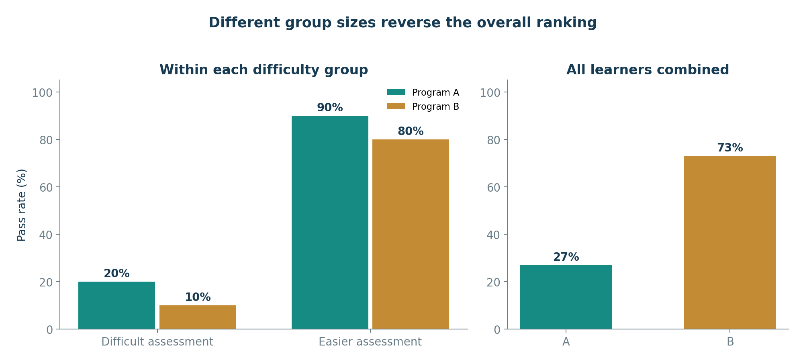

Две тренировъчни програми, А и Б, подготвят обучаващите се за тестове. Някои обучаващи се се опитват да направят трудна оценка; други приемат по - лесна. Във всеки вид оценка А постига по-висока скорост на преминаване. И все пак, когато двете групи са комбинирани, общият процент на Б е много по-висок. Как може и двете да са истина? Отговорът не е математически трик: програмите обслужват много различни пропорции на обучаващите се във всяка категория трудности.

Това е нарочно хипотетичен набор от данни. При трудната оценка А преминава 18 от 90 ученика (20 процента), докато В преминава 1 от 10 (10 процента). При по-лесната оценка А преминава 9 от 10 (90 процента), докато В преминава 72 от 90 (80 процента). Програма А се справя по-добре и в двете групи с трудности. Но общо А преминава 27 от 100 (27 процента), докато В преминава 73 от 100 (73%). Програмата А има по-голямата част от обучаващите се, които взимат трудния тест; Програмата Б най-много взема лесния. Общият резултат отразява тази поразителна разлика в състава на групата.

<figure class="figure" id="figure-6-6">

<figcaption>Фигура 6.6. Програма А превъзхожда B в двете категории трудности, но B има по-висока комбинирана скорост на преминаване, защото съставите на групата се различават. <a class="figure-anchor" href="#figure-6-6" aria-label="Link to this figure">#</a></figcaption>
</figure>

Това е форма на парадокс Симпсън, в която асоциация присъства в рамките на групи може да се обърне, когато тези групи са обобщени. Името звучи мистериозно, но механизмът е разбираем: когато размерът на групата се различава, комбинираното средно тегло на подгрупите по различен начин. Сравняването на програмите в рамките на всяка категория трудности е необходимо преди тълкуването на общата ставка. Необходимо е също така да се запитаме дали по-трудна категория е уловила всички значими разлики. Превъзходният описателен процент в подгрупите не е автоматично причинен ефект на програмата.

Урокът пътува широко. Една болница лекува по-сложни случаи. Едно училище обслужва повече ученици с ограничена предварителна подготовка. Един град включва много по - възрастни жители. Една компания продава предимно стоки с ниско съдържание на маргин, а друга - предимно премиум стоки. Ако съставът на групата се различава, общата средна стойност може да предполага погрешно класиране. По - добрите сравнения често изискват стратификация, стандартизиране или статистически модели. Но изборът на кои променливи да се контролират изисква съществено разбиране, не само математическа интелигентност.

Последно предупреждение: разделянето на всичко на все по-малки групи въвежда други рискове, включително малки проби, шумни проценти и избори, направени след като са видели резултатите. Отговорните анализатори балансират необходимостта от обективно сравнение с опасността от изготвяне на крехки оценки. Парадоксът трябва да ви направи по-внимателни, а не цинични за всички обобщени статистически данни.
