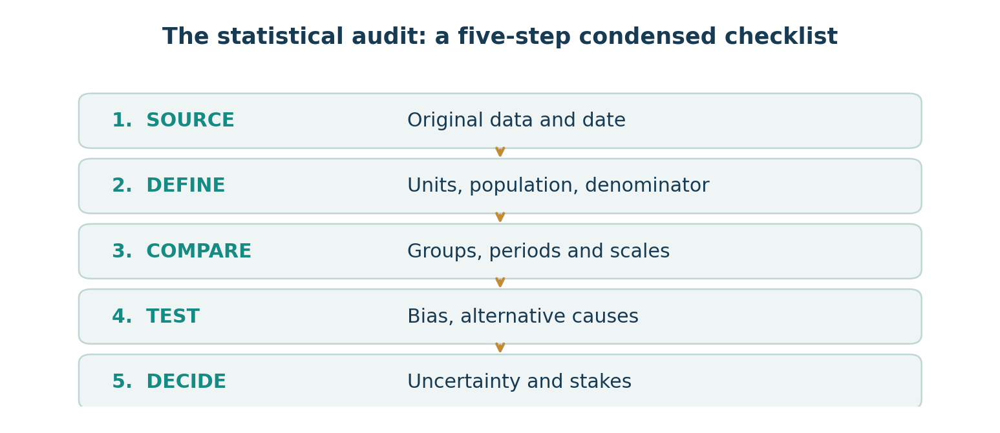

Когато се сблъскате с числено твърдение, следвайте кратко разследване. Първо, преформулирайте претенцията на неутрален език и идентифицирайте количеството. Второ, намерете първоначалните данни, датата на публикуване и производителя на данните. Трето, назовете единицата за наблюдение, целевата популация, времевия период и знаменателя. Четвърто, провери разпределението, групата за сравнение и скалата на графиката. Пето, да се оцени как са били избрани наблюденията и как са третирани липсващите данни. Шести, отделно наблюдавано сдружение от предложената причинно-следствена връзка и намери поне едно алтернативно обяснение. Седмо, попитай за несигурността и какво практично решение, ако има такова, подкрепят доказателствата.

Това не е искане да се изчисли интервал на доверие всеки път, когато някой споменава цена. Едно бързо искане може да изисква само бърза проверка. Но залозите трябва да определят грижите, които инвестираш. Малка грешка в приятелски разговор е едно нещо; статистическа грешка зад голямо финансово решение или публична политика е друго. Интелектуалната зрялост включва да знаеш кога отговорът е очевиден, кога е несигурен и кога липсва информацията, необходима за вземане на решение.

<figure class="figure" id="figure-6-8">

<figcaption>Фигура 6.8. Кондензиран контролен списък за разследване на статистическа претенция преди да я повтори или да вземе решение. <a class="figure-anchor" href="#figure-6-8" aria-label="Link to this figure">#</a></figcaption>
</figure>

<strong>Последна връзка с останалата част от книгата:</strong> статистиката не може да замени историята, географията, икономиката или преценката. Те зависят от всички тях. Една и съща серия доходи означава различни неща в рамките на различни политически системи; степента на заболяването се нуждае от демографски контекст; климатичната диаграма се нуждае от познания за физическото измерване; изборният резултат се нуждае от разбиране на институциите. Числата са най-силни, когато принадлежат към последователно обяснение и най-слаби, когато са отделени от животите и процесите, които описват.
