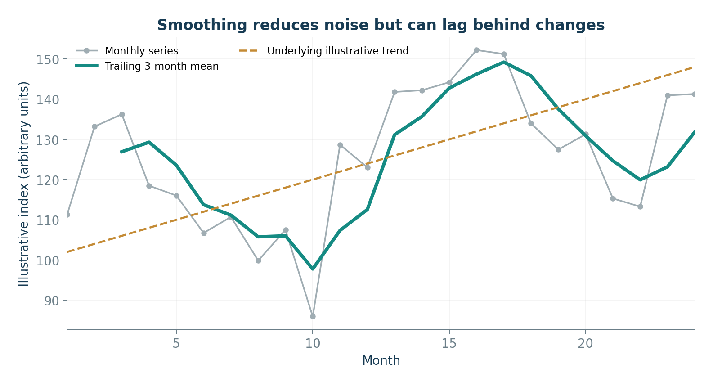

Времевата серия измерва нещо многократно през времето. Линията може да изглежда като стабилен напредък, когато тя започва в ниска точка, или стагнация, когато тя започва от връх. Избор на начална дата след като видите данните е форма на черешка. Драматичната годишна промяна може да отразява пандемия, война, необичайно тежка зима, данъчна промяна или ревизия на отчетите, а не трайна тенденция. Погледнете достатъчно история, за да прецените твърдението, но не толкова, че да скриете специфичната промяна, която се обсъжда.

Сезоналността има огромно значение. Магазините продават различни стоки по Коледа, ваканционните градове стават претъпкани през лятото, а търсенето на отопление се увеличава през зимата. Сравняването на приходите от юли с приходите от декември може да бъде по-малко полезно от сравняването на юли с предходния юли. Анализаторите често използват сезонна корекция или годишна промяна, за да направят моделите по-лесни за тълкуване. Тези методи помагат, но не премахват основната несигурност. В малък магазин, еднократна насипни клиенти все още могат да доминират едно месечно сравнение.

Движещата се средна изглажда краткосрочната промяна. За месечните продажби от €100, €120 и €80 средната стойност за три месеца е €100. Добавете четвърти месец от 160 € и новата средна стойност за три месеца става (120 EUR + 80 € + 160)/3 = 120 €. Изглаждането прави широкия модел по-ясен, но въвежда изоставане и може да прикрие внезапни промени. Ако се разгръща извънредна ситуация, изгладената линия може да не е най-добрият показател за незабавно решение.

<figure class="figure" id="figure-6-4">

<figcaption>Фигура 6.4. Измислена времева серия показваща сурови наблюдения, пълзяща средна и схематична тенденция. <a class="figure-anchor" href="#figure-6-4" aria-label="Link to this figure">#</a></figcaption>
</figure>

Винаги питайте дали серията е номинална или спрямо инфлацията, дали нейното население се е променило и дали дефиницията се е променила с течение на времето. Една вековна икономическа графика, която сменя границите, валутите или методите без разкриване, предизвиква фалшива прецизност. Често най-трудната част от изучаването на миналото е да се направи за разлика от периоди, сравними без изтриване на разликите, които ги правят интересни.
