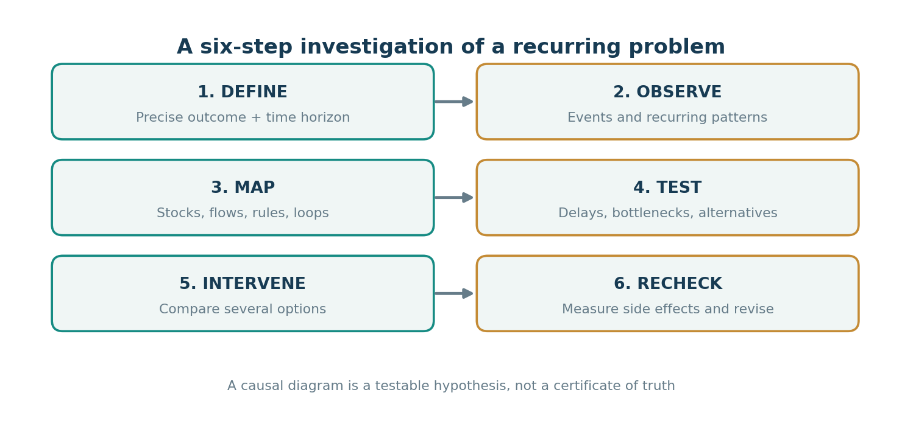

Когато срещнете повтарящ се проблем, опитайте тази компактна последователност. Дефинирай резултата в измерими термини и избери времеви хоризонт. Проследи модела, вместо да разчиташ на едно драматично събитие. Идентифицирайте акциите и потоците: какво се натрупва, какво влиза, какво оставя? Карта линии и забавяния: какво променя поведението в отговор на променящите се условия, и колко късно? Потърсете ограничения и външни ефекти: затруднения, общи ресурси, пренебрегвани хора или разходи изпреварват другаде. Предложете повече от една намеса и прогнозирайте нейните планирани и непредвидени последици. Тест и преразглеждане: да реши каква информация ще ви каже, че интервенцията работи.

Въпросът за системите често е по-разкрит от въпроса за вината: Какви правила или ограничения могат да създадат това поведение дори сред добронамерените хора? Но тя не трябва да заменя моралната преценка или отговорността. По време на война хората все още избират да нахлуят или преговарят. В една компания мениджърите все още избират дали да мамят клиентите. В публична институция длъжностните лица все още имат задължения. Структурата обяснява стимулите и ограниченията; тя не освобождава лицата от техните решения.

Инструментите също предпазват от две противоположни грешки. Единият е редуцирането, ако приемем, че един сложен резултат трябва да има една причина. Другото е неяснота, казвайки, че всичко е взаимосвързано и следователно нищо определено не може да бъде известно. Най-добрият мислител на системите е конкретен: тук са актьорите, запасите, потоците и механизмите; тук са измерванията; тук е това, което е несигурно; ето един разумен тест.

<figure class="figure" id="figure-7-10">

<figcaption>Фигура 7.10. Практичният цикъл превръща системите в хипотези в видими тестове и преразгледани решения. <a class="figure-anchor" href="#figure-7-10" aria-label="Link to this figure">#</a></figcaption>
</figure>
