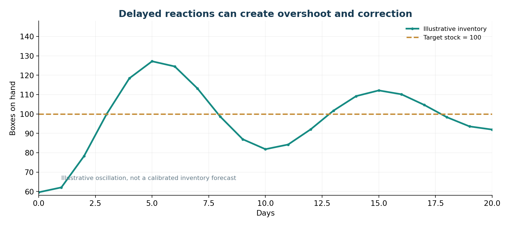

Представете си шофиране с замръзнало предно стъкло и управление от мястото, където пътят изглеждаше преди няколко секунди. Завиваш надясно, чакай, не виждаш подобрение, завиваш надясно и изведнъж осъзнаваш, че колата вече е прекрачила централната линия. Забавената информация може да направи прекомерно коригиращи действия. Това е ярка форма на общ проблем със системите: отговорът се случва след решението, докато се вземат нови решения преди да е пристигнал предишният отговор.

Да разгледаме измислен магазин с целева инвентаризация от 100 кутии и петдневно забавяне на доставката. В понеделник той вижда 50 кутии, така че поръчва 50. Във вторник все още има 50, и поръчва още 50. Ако той не изпълни неплатените поръчки, той може да продължи да поръчва, докато 250 кутии са на път. Когато доставките най-накрая пристигнат, магазинът е зареден и започва да отменя поръчките. След някои продажби, тя може да се люлее към недостиг отново. Конкретната аритметика е илюстративна; реалните правила за поръчка обикновено са по-сложни. Ключът е, че забавяне плюс агресивна корекция и непълна информация могат да генерират цикли.

Подобни механизми могат да възникнат и в строителството, селскостопанските доставки, образованието и здравеопазването. На новите жилища им трябват години, така че сегашните цени влияят върху инвестициите, които пристигат дълго след промяната на търсенето. Обучението на лекари отнема много години, така че краткосрочен недостиг не може да бъде решен веднага чрез добавяне на университетски места. При екологичното управление популацията на рибите може да реагира бавно на промените в налягането при прибиране на реколтата. Ако решенията разчитат на остарели измервания, мениджърите рискуват да надвишат устойчивото ниво.

Добрият отговор не винаги е да действаш по-бързо. Понякога по-безопасният подход е да се намали силата на всяка корекция, да се отчитат вече поети ангажименти, да се подобри навременността на информацията или да се промени правилото за вземане на решения. Забавянето се различава: административното забавяне понякога може да бъде намалено, докато биологичният растеж или времето за изграждане не могат просто да бъдат пропуснати.

<figure class="figure" id="figure-7-4">

<figcaption>Фигура 7.4. Схематична инвентарна осцилация илюстрира защо забавената обратна връзка и повтарящата се корекция могат да надскочат. <a class="figure-anchor" href="#figure-7-4" aria-label="Link to this figure">#</a></figcaption>
</figure>
