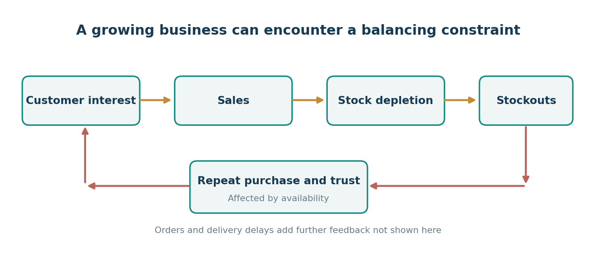

Да разгледаме един измислен град, в който търсенето на жилища расте бързо. Наемът се покачва, сигнализирайки за възможност за разработчици. Но строителството изисква разрешителни, финансиране, труд и време. Новите сгради могат да се отворят две или три години след първоначалния прилив на търсене. Ако много разработчици реагират на същия price сигнал наведнъж, допълнително предлагане може да пристигне точно както търсенето забавя, създаване на свободни работни места и падащи наеми. Тази корекция от типа паяжина е възможна при определени условия на предлагане, търсене и очакване; не е универсална прогноза, че всеки бум завършва в катастрофа.

Цените вършат няколко неща. Те дават сигнали за недостиг, насърчават промените в предлагането и търсенето и координират решенията между хора, които не се познават. Но цените могат да бъдат бавни, шумни или непълни показатели. Цената може да пропусне разходите за замърсяване, неплатени грижи, бъдещи щети или рискове за сигурността. Ако дадена фабрика може да изхвърля отпадъци, без да носи разходите надолу по веригата, нейното частно изчисление се различава от социалните разходи. Икономистите наричат такива ефекти външни фактори. Политиките понякога могат да подобрят информацията и стимулите в системата чрез стандарти, данъци, правила за собственост, субсидии или регулиране, всяка със свои собствени компромиси.

Финансовите пазари добавят очаквания към обратната връзка. Повишаващите се цени на активите могат да привлекат внимание и заеми; повишеното търсене може да повиши цените допълнително. Ако участниците смятат, че цените могат само да се покачват, цикълът може да се засили. Но по-високите оценки, кредитните ограничения, променящите се очаквания и пазарните корекции могат да го прекъснат. Едно просто положително описание не ни казва кога съществува балон или колко голяма корекция ще бъде. Тези решения изискват доказателства за фундаменти, финансиране, институционални условия и разпределение на риска.

Едно от най-полезните икономически различия е между дефицит на потока и дългов фонд. Правителството, което има дефицит след една година, добавя към дълговия си фонд по опростено счетоводство, въпреки че счетоводните данни и други корекции могат да имат значение. Домакинство, което печели 2000 € и харчи 2200 € месечно, добавя приблизително 200 € заеми или намалява спестяванията всеки месец; общият натрупан дълг зависи от началната му позиция, лихви и плащания. Объркването на еднопериодния поток с натрупаните запаси може да направи публичните обсъждания на бюджетите почти безсмислени.

<figure class="figure" id="figure-7-7">

<figcaption>Фигура 7.7. Продажбите, наличността и доверието на клиентите си взаимодействат; реалните операции включват допълнително забавени процеси. <a class="figure-anchor" href="#figure-7-7" aria-label="Link to this figure">#</a></figcaption>
</figure>
